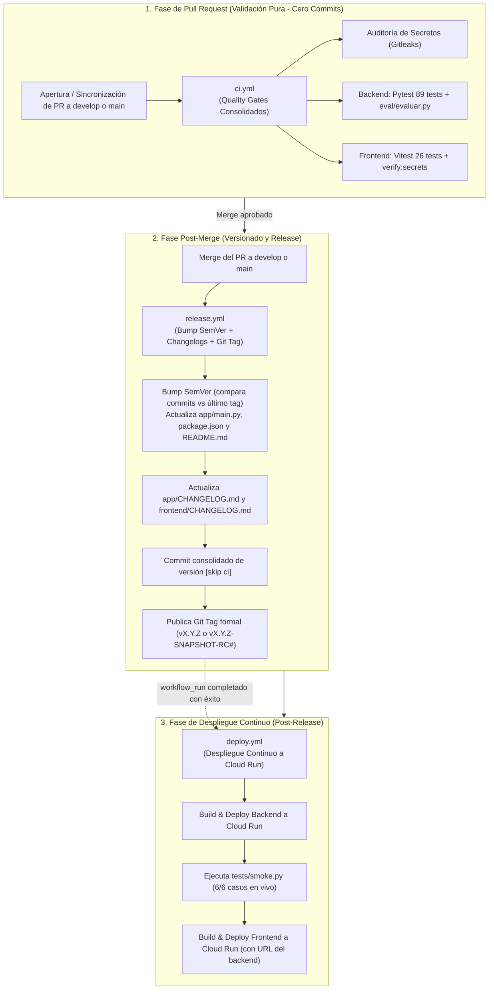

# Pipelines de CI/CD · GuíaVital

Este directorio contiene los flujos de trabajo (*workflows*) automatizados de **GitHub Actions** para el asistente médico **GuíaVital**. La arquitectura sigue las mejores prácticas de **Site Reliability Engineering (SRE)** y principios **SOLID (Responsabilidad Única)**.

---

## 🗺️ Mapa del Ciclo de Vida Automatizado

---

## 📋 Catálogo Consolidado de Workflows

### 1. Calidad en Pull Request (`ci.yml`)
* **Disparador:** `pull_request` y `push` (`main`, `develop`) o ejecución manual (`workflow_dispatch`).
* **Misión:** Validar estrictamente la integridad del código sin realizar modificaciones ni commits.
* **Compuertas:**
  1. **Auditoría de Secretos (`secret-scan`):** Ejecuta Gitleaks en todo el repositorio (`secretos.yml`).
  2. **Calidad de Backend (`backend-quality-gate`):** Ejecuta las 89 pruebas unitarias (`pytest -q`) y el evaluador del Plan de Calidad (`python eval/evaluar.py`).
  3. **Calidad de Frontend (`frontend-quality-gate`):** Ejecuta las 26 pruebas de Vitest (`npm test`) y la verificación de claves en el bundle web (`npm run verify:secrets`).

---

### 2. Versionado y Release Post-Merge (`release.yml`)
* **Disparador:** Automático al fusionar un PR (`pull_request: closed` con `merged == true`) hacia `main` o `develop`, o manual (`workflow_dispatch`).
* **Misión:** Centralizar el cálculo de SemVer, actualización de bitácoras y generación del tag.
* **Pasos:**
  1. **Bump SemVer:** Ejecuta `scripts/semver_bumper.py`:
     - **En `main`:** Compara contra el último tag formal de **Release** (`vX.Y.Z`).
     - **En `develop`:** Compara contra el último tag de **Snapshot** (`vX.Y.Z-SNAPSHOT-RC#`).
     - Actualiza simétricamente `app/main.py`, `frontend/package.json` y `README.md`.
  2. **Changelogs:** Actualiza las bitácoras mediante `scripts/actualizar_changelog.py`.
  3. **Commit Consolidado:** Realiza un único commit con la metadata del release.
  4. **Tageo:** Crea y empuja el Git Tag correspondiente.

---

### 3. Despliegue Continuo a Cloud Run (`deploy.yml`)
* **Disparador:** Automático vía `workflow_run` al completarse con éxito `release.yml` (o manual vía `workflow_dispatch`).
* **Misión:** Construcción de imágenes Docker, despliegue serverless y validación funcional en vivo.
* **Pasos:**
  1. **Backend:** Construye la imagen Docker (`app/Dockerfile`) y despliega `guiavital-backend` en Google Cloud Run.
  2. **Pruebas de Humo:** Ejecuta `python3 tests/smoke.py` evaluando en vivo los 6 casos de salud, triaje y seguridad contra la URL del backend.
  3. **Frontend:** Resuelve dinámicamente la URL del backend, compila `frontend/Dockerfile` y despliega `guiavital` en Cloud Run.

---

### 4. Flujos de Soporte
* **`secretos.yml`:** Flujo reusable (`workflow_call`) para el análisis con Gitleaks invocado por `ci.yml`.
* **`infra-gcp.yml`:** Flujo manual (`workflow_dispatch`) para aprovisionamiento inicial de infraestructura en Google Cloud Platform.
