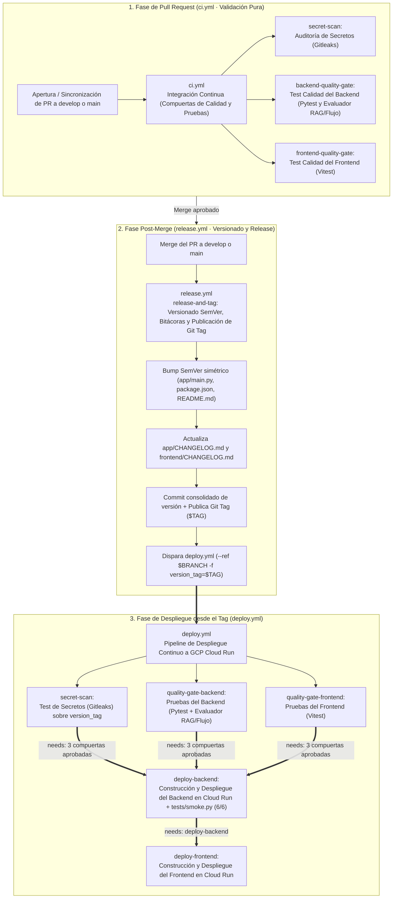

# Pipelines de CI/CD · GuíaVital

Este directorio contiene los flujos de trabajo (*workflows*) automatizados de **GitHub Actions** para el asistente médico **GuíaVital**. La arquitectura sigue las mejores prácticas de **Site Reliability Engineering (SRE)** y principios **SOLID (Responsabilidad Única)**.

---

## 🗺️ Mapa del Ciclo de Vida Automatizado

---

## 📋 Catálogo Consolidado de Workflows

### 1. Integración Continua (`ci.yml`)
* **Nombre:** `Integración Continua (Compuertas de Calidad y Pruebas)`
* **Disparador:** **Únicamente en `pull_request`** (`opened`, `synchronize`, `reopened`) hacia `main` y `develop` (o manual vía `workflow_dispatch`). No se ejecuta en eventos `push`.
* **Misión:** Validar estrictamente la integridad del código del PR sin realizar modificaciones ni commits.
* **Jobs:**
  1. **`secret-scan` (`Auditoría de Secretos (Gitleaks)`):** Reutiliza `secretos.yml` para analizar todo el historial con Gitleaks.
  2. **`backend-quality-gate` (`Test Calidad del Backend (Pytest y Evaluador RAG/Flujo)`):** Ejecuta las 92 pruebas unitarias (`pytest -q`) y el evaluador del Plan de Calidad (`python eval/evaluar.py`).
  3. **`frontend-quality-gate` (`Test Calidad del Frontend (Vitest)`):** Ejecuta la verificación de claves en el bundle web (`npm run verify:secrets`) y las 27 pruebas de Vitest (`npm test`).

---

### 2. Publicación y Tageo de Versiones Post-Merge (`release.yml`)
* **Nombre:** `Publicación y Tageo de Versiones (Post-Merge)`
* **Disparador:** Automático al fusionar un PR (`pull_request: closed` con `merged == true`) hacia `main` o `develop`, o manual (`workflow_dispatch`).
* **Job:** **`release-and-tag` (`Versionado SemVer, Bitácoras y Publicación de Git Tag`)**
* **Pasos:**
  1. **Bump SemVer:** Ejecuta `scripts/semver_bumper.py` sobre la rama destino (`main` $\rightarrow$ `vX.Y.Z`, `develop` $\rightarrow$ `vX.Y.Z-SNAPSHOT-RC#`) actualizando simétricamente `app/main.py`, `frontend/package.json` y `README.md`.
  2. **Changelogs y Commit Consolidado:** Actualiza `app/CHANGELOG.md` y `frontend/CHANGELOG.md` (`scripts/actualizar_changelog.py`) y empuja el commit de versión consolidado.
  3. **Publicación del Git Tag:** Crea y publica el tag formal (`$TAG`).
  4. **Disparo de Despliegue con Tag:** Invoca `gh workflow run deploy.yml --ref "$BRANCH" -f version_tag="$TAG"`, enviando la rama donde se realizó el merge y el tag exacto.

---

### 3. Pipeline de Despliegue Continuo a GCP Cloud Run (`deploy.yml`)
* **Nombre:** `Pipeline de Despliegue Continuo a GCP Cloud Run`
* **Disparador:** `workflow_dispatch` con input requerido `version_tag` (invocado automáticamente al finalizar `release.yml` o manualmente indicando el tag).
* **Misión:** Tomar el `version_tag` generado, validar las compuertas bloqueantes de secretos y pruebas sobre ese tag, construir las imágenes Docker y desplegar en Google Cloud Run.
* **Jobs:**
  1. **`secret-scan` (`Test de Secretos (Gitleaks) sobre ${{ inputs.version_tag }}`):** Reutiliza `secretos.yml` para validar que no existan secretos filtrados.
  2. **`quality-gate-backend` (`Pruebas del Backend (Pytest + Evaluador RAG/Flujo)`):** Descarga el código desde `inputs.version_tag` y ejecuta `pytest -q` (92 pruebas) y `python eval/evaluar.py`.
  3. **`quality-gate-frontend` (`Pruebas del Frontend (Vitest)`):** Descarga el código desde `inputs.version_tag` y ejecuta `npm run verify:secrets` y `npm test` (27 pruebas).
  4. **`deploy-backend` (`Construcción y Despliegue del Backend en Cloud Run`):** Bloqueado por `needs: [secret-scan, quality-gate-backend, quality-gate-frontend]`. Construye `app/Dockerfile` desde `inputs.version_tag`, despliega `guiavital-backend` en Cloud Run vinculando Secret Manager y valida `/manage/info`, `/manage/health` y `tests/smoke.py` (6/6 casos en vivo).
  5. **`deploy-frontend` (`Construcción y Despliegue del Frontend en Cloud Run`):** Bloqueado por `needs: [deploy-backend]`. Construye `frontend/Dockerfile` desde `inputs.version_tag`, despliega `guiavital` en Cloud Run y valida `/manage/health`.

---

### 4. Flujos de Soporte
* **`secretos.yml` (`Auditoría y Detección de Secretos`):** Se ejecuta automáticamente en cada `push` a cualquier rama de trabajo (excepto `main` y `develop` vía `branches-ignore: [main, develop]`), y además actúa como flujo reusable (`workflow_call` / `workflow_dispatch`) con el job **`gitleaks` (`Escaneo de secretos con Gitleaks`)** invocado por `ci.yml` y `deploy.yml`.
* **`infra-gcp.yml`:** Flujo manual (`workflow_dispatch`) para aprovisionamiento inicial de infraestructura en Google Cloud Platform.
