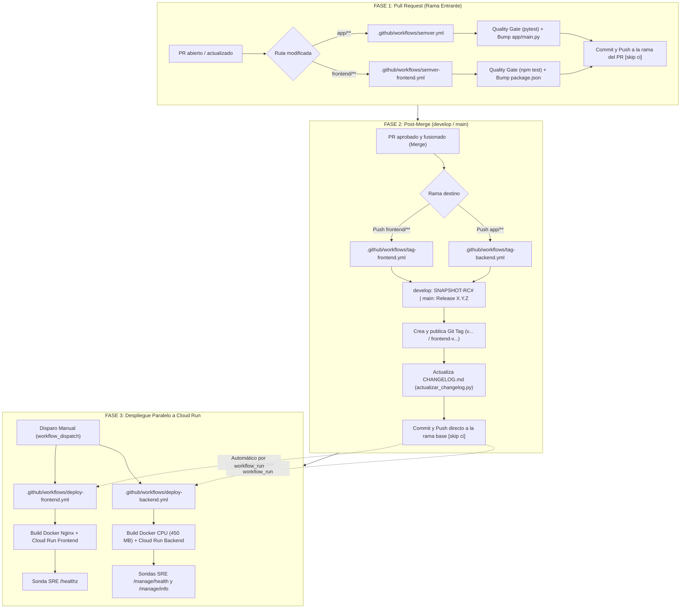

# 05. Especificación de CI/CD: Automatización de Versionado SemVer y Despliegue Continuo (Backend y Frontend)

**Rol:** Site Reliability Engineer (SRE)  
**Proyecto:** GuíaVital · Asistente de Orientación en Salud Pública sobre Dengue y Arbovirosis  

---

## 1. Reglas y Convenciones de Versionado SemVer

### 1.1. Convención de Commits y Reglas de Incremento
Los pipelines de GitHub Actions analizan los mensajes de commit (*Conventional Commits*) para determinar el incremento SemVer:
- **`feat:`** Nuevas funcionalidades o endpoints $\rightarrow$ Incremento **MINOR** (ej. `0.1.0` $\rightarrow$ `0.2.0`).
- **`fix:`** Corrección de errores o bugs $\rightarrow$ Incremento **PATCH** (ej. `0.1.0` $\rightarrow$ `0.1.1`).
- **`refactor:`** Reestructuración de código sin alterar funcionalidad externa $\rightarrow$ Incremento **PATCH**.
- **`chore:`** Tareas de mantenimiento, dependencias o configuración $\rightarrow$ Incremento **PATCH**.
- **`test:`** Pruebas unitarias o de integración $\rightarrow$ Incremento **PATCH**.
- **`docs:`** Cambios en documentación técnica y especificaciones $\rightarrow$ Incremento **PATCH** (si acompaña cambios en código).
- **`BREAKING CHANGE:` o sufijo `!` (ej. `feat!:`, `fix!:`):** Cambios incompatibles con versiones previas $\rightarrow$ Incremento **MAJOR** (ej. `0.1.0` $\rightarrow$ `1.0.0`).

### 1.2. Estrategia por Ramas (Releases vs Snapshots con Simetría Backend/Frontend)
- **Simetría de Versiones y Tags:** Backend y Frontend comparten exactamente la misma versión SemVer y el mismo formato de tag Git (`vX.Y.Z` o `vX.Y.Z-SNAPSHOT-RC#`), garantizando paridad de entrega.
- **Rama `main` (Releases de Producción):**
  - Genera versiones oficiales definitivas con formato SemVer estricto: `X.Y.Z` (sin sufijos pre-release).
  - Tags Git simétricos: `vX.Y.Z`.
- **Rama `develop` (Snapshots de Pre-producción):**
  - Genera versiones con nomenclatura `X.Y.Z-SNAPSHOT-RC#`.
  - El correlativo `RC#` incrementa secuencialmente en cada entrega hacia `develop` (ej. `0.2.0-SNAPSHOT-RC1`, `0.2.0-SNAPSHOT-RC2`).
  - Tags Git simétricos: `vX.Y.Z-SNAPSHOT-RC#`.

### 1.3. Expresión Regular Oficial SemVer 2.0
Toda versión generada o manual valida estrictamente contra:
```regex
r"^(0|[1-9]\d*)\.(0|[1-9]\d*)\.(0|[1-9]\d*)(?:-((?:0|[1-9]\d*|\d*[a-zA-Z-][0-9a-zA-Z-]*)(?:\.(?:0|[1-9]\d*|\d*[a-zA-Z-][0-9a-zA-Z-]*))*))?(?:\+([0-9a-zA-Z-]+(?:\.[0-9a-zA-Z-]+)*))?$"
```

### 1.4. Manejo de Modificaciones Manuales de Versión
Si el desarrollador ya modificó manualmente `APP_VERSION` en `app/main.py` o `version` en `frontend/package.json`, el pipeline valida el formato SemVer y respeta dicho valor sin sobreescribirlo.

---

## 2. Arquitectura de Ciclo de Vida en Dos Fases

Para evitar tags huérfanos o modificaciones prematuras en `CHANGELOG.md` por Pull Requests cancelados o rechazados, el versionado opera en dos fases desacopladas:



---

## 3. Matriz de Workflows de GitHub Actions

| Archivo de Workflow | Disparador (Trigger) | Evento / Alcance | Responsabilidad (SOLID) |
| :--- | :--- | :--- | :--- |
| **`semver.yml`** | `pull_request` (`app/**`) | En rama del PR | **Fase 1 Backend**: Tests backend + Bump de `APP_VERSION` en `app/main.py`. |
| **`tag-backend.yml`** | `pull_request` (`closed` & `merged`) hacia `main`/`develop` | Post-Merge | **Fase 2 Backend**: Tag Git simétrico (`v...`) + Actualización de `app/CHANGELOG.md`. |
| **`semver-frontend.yml`** | `pull_request` (`frontend/**`) | En rama compare del PR | **Fase 1 Frontend**: Tests frontend + Bump en `package.json` y `package-lock.json`. |
| **`tag-frontend.yml`** | `pull_request` (`closed` & `merged`) hacia `main`/`develop` | Post-Merge | **Fase 2 Frontend**: Tag Git simétrico (`v...`) + Actualización de `frontend/CHANGELOG.md`. |
| **`deploy-backend.yml`** | `workflow_dispatch` o `workflow_run` de `tag-backend` | Despliegue | **Instalación Backend**: Build Docker CPU + Despliegue `guiavital-backend` a Cloud Run. |
| **`deploy-frontend.yml`** | `workflow_dispatch` o `workflow_run` de `tag-frontend` | Despliegue | **Instalación Frontend**: Inyección URL API + Despliegue `guiavital` a Cloud Run. |

---

## 4. Historias de Usuario SRE

### HU-CICD-01: Versionado SemVer y Bump en Pull Request (Fase 1)
- **Historia:** Como SRE, quiero que al abrir o sincronizar un Pull Request hacia `develop` o `main`, el pipeline ejecute los tests automatizados e incremente la versión exclusivamente en la rama compare (`github.head_ref`), ignorando modificaciones en los archivos CHANGELOG, para asegurar trazabilidad antes de la integración sin alterar la rama base ni ciclar ejecuciones.
- **Criterios de Aceptación:**
  1. Si el PR modifica código en `app/**` o `frontend/**`, ejecuta sus pruebas respectivas y calcula la versión SemVer.
  2. **Exclusión de Changelogs:** La modificación de `app/CHANGELOG.md`, `frontend/CHANGELOG.md` o `CHANGELOG.md` **no** activa el pipeline de SemVer (`paths` con `!**CHANGELOG.md`).
  3. **Actualización de Compare Branch:** El commit con la versión incrementada se empuja exclusivamente a la rama compare (`HEAD:${{ github.head_ref }}`), **nunca** a la rama base (`base_ref`).
  4. **No** crea tags Git ni modifica archivos changelog en esta fase.

### HU-CICD-02: Publicación de Tag Simétrico y Actualización de Changelogs Post-Merge (Fase 2)
- **Historia:** Como SRE, quiero que cuando un PR se fusione en `develop` o `main`, se genere el tag formal simétrico de Git (`v...`) y se actualice automáticamente la bitácora específica de cada aplicación (`app/CHANGELOG.md` para backend y `frontend/CHANGELOG.md` para frontend, registrando 'No hubo cambios' si no hubo commits), para garantizar paridad y trazabilidad limpia.
- **Criterios de Aceptación:**
  1. En `develop`, genera tags simétricos con formato `vX.Y.Z-SNAPSHOT-RC#`.
  2. En `main`, genera tags simétricos de release oficial `vX.Y.Z`.
  3. Ejecuta `scripts/actualizar_changelog.py --version "$VERSION" --file <ruta>`, promocionando la sección `[Unreleased]`. Si no hay notas o commits en la carpeta, registra `- No hubo cambios.` sin fallar.
  4. Realiza commit y push directo a la rama base con `[skip ci]`.

### HU-CICD-03: Despliegue Continuo en Paralelo y Manual a GCP Cloud Run (Fase 3)
- **Historia:** Como SRE, quiero contar con workflows de instalación y despliegue desacoplados que puedan ejecutarse automáticamente tras el merge en paralelo o dispararse manualmente por demanda, para minimizar el tiempo de entrega y permitir el mantenimiento independiente de cada servicio.
- **Criterios de Aceptación:**
  1. `deploy-backend.yml` y `deploy-frontend.yml` pueden ejecutarse manualmente en cualquier momento mediante `workflow_dispatch`.
  2. Al completarse exitosamente el post-merge (`tag-backend.yml` o `tag-frontend.yml`), el workflow de despliegue correspondiente se activa automáticamente vía `workflow_run`.
  3. Si ambos servicios se fusionan simultáneamente, ambos despliegues se ejecutan **en paralelo** sin bloquearse entre sí.
  4. `deploy-backend.yml` utiliza la imagen optimizada con PyTorch CPU (`~450 MB`) e inyecta secretos desde GCP Secret Manager.
  5. `deploy-frontend.yml` resuelve dinámicamente la URL del backend mediante `gcloud run services describe`, compila los estáticos con Nginx y verifica `/healthz`.
