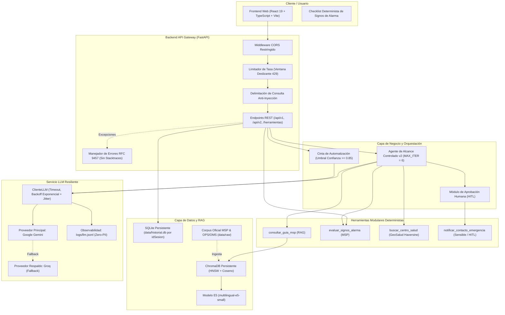

# GuíaVital · Asistente de Orientación en Salud Pública sobre Dengue y Arbovirosis

> **Nombre Oficial / Nombre Corto (`APP_NAME`):** `GuíaVital`  
> **Versión Actual:** `0.2.2` (SemVer)  
> **Caso:** 05 - Grupo 5 · Seminario de Titulación UNIANDES  
> **Repositorio Oficial en GitHub:** `https://github.com/UNIPI6TO/PROY_GRADUACION_ASISTENTE_MEDICO_APP`  
> **Despliegue Público (Cloud Run):** `https://guiavital-533967484439.us-central1.run.app`  
> **API Backend Pública (Swagger UI):** `https://guiavital-backend-533967484439.us-central1.run.app/docs`

---

## Integrantes y Responsabilidades

| Integrante | Rol | Responsabilidades Específicas |
|---|---|---|
| **Luis Cahuana** | Tech Lead | Arquitectura general del sistema, diseño y calibración del pipeline RAG (`intfloat/multilingual-e5-small` + ChromaDB), diseño de herramientas deterministas clínicas MSP, versionado de prompts del sistema y supervisión de calidad técnica. |
| **Wilson Salinas** | Builder | Desarrollo de la interfaz web en React 19 + TypeScript, máquina de estados finitos, integración de endpoints v1 y v2 (Agente de alcance controlado con *Function Calling*), orquestación de CI/CD en GitHub Actions y despliegue continuo en Google Cloud Run. |
| **Rafael Minaya** | QA / Seguridad | Estrategia y diseño de pruebas automatizadas unitarias e integrales (`pytest`, `Vitest`), auditoría de seguridad y formulación de la matriz de riesgos OWASP LLM (`docs/riesgos.md`), límite de tasa (`LimitadorTasa`), delimitación anti-inyección y prevención de fuga de secretos. |

---

## Propósito del Sistema

### 1. ¿Qué problema resuelve?
En Ecuador, especialmente en las provincias costeras y amazónicas durante las temporadas de lluvias, el dengue representa una crisis recurrente de salud pública. Este proyecto aborda de raíz tres problemas críticos:
1. **Automedicación peligrosa:** Pacientes con síndrome febril suelen recurrir a analgésicos y antiinflamatorios no esteroideos comunes (AINEs como ibuprofeno, aspirina, diclofenaco o naproxeno) que incrementan sustancialmente el riesgo de hemorragias masivas y choque en dengue.
2. **Reconocimiento tardío de signos de alarma:** La falta de identificación oportuna de signos críticos de extravasación plasmática (dolor abdominal continuo, vómitos persistentes, sangrado de mucosas, letargo) retrasa el ingreso hospitalario oportuno, incrementando la letalidad evitable.
3. **Colapso innecesario de salas de guardia:** Falta de un canal inicial confiable de orientación preventiva que clasifique de forma inmediata a los pacientes y los derive a centros de atención primaria o al servicio de emergencias según su nivel de severidad.
4. **Desinformación:** Respuestas no estructuradas o alucinadas en internet sin respaldo clínico oficial.

### 2. ¿Para quién está diseñado?
- **Población general y familias:** Residentes de zonas endémicas del Ecuador (Guayas, Manabí, Los Ríos, El Oro, Santo Domingo, Esmeraldas, Sucumbíos, entre otras) que requieren orientación inmediata ante cuadros febriles propios o de familiares.
- **Cuidadores de pacientes vulnerables:** Familias a cargo de lactantes, mujeres embarazadas o adultos mayores con comorbilidades.
- **Personal de salud comunitaria:** Promotores de salud y orientadores que necesitan una herramienta de apoyo rápido estandarizada bajo directrices del MSP.

### 3. Alcance Positivo
- **Orientación informativa contextualizada:** Responde consultas sobre prevención, erradicación de criaderos del mosquito *Aedes aegypti*, hidratación oral, fases de la enfermedad y síntomas habituales según las guías del MSP y la OPS.
- **Trazabilidad y abstención responsable:** Estructura cada respuesta en JSON validado (`RespuestaAsistente`), indicando explícitamente si el sistema debe abstenerse (`se_abstiene: true`), a qué entidad derivar (`derivar_a`) y las fuentes documentales (`fuentes`).
- **Checklist determinista de signos de alarma:** Triaje algorítmico interactivo en interfaz para evaluar signos de peligro (dolor abdominal intenso y continuo, vómitos persistentes, sangrado de mucosas, letargo o irritabilidad, hipotensión postural/mareos, dificultad respiratoria) sin delegar el cálculo de riesgo al LLM.
- **Derivación médica inmediata:** Ante la detección de cualquier signo de alarma o grupo de riesgo (embarazadas, lactantes, adultos mayores o personas con comorbilidades), indica acudir de inmediato al **Centro de Salud MSP** más cercano o llamar al **ECU-911**.
- **Memoria conversacional aislada por sesión:** Persistencia multi-turno en SQLite (`data/historial.db`) asociada únicamente a un identificador anónimo de sesión (`idSesion`).
- **Endpoints de gestión operativa:** Diagnóstico de salud (`GET /manage/health`) y metadatos con validación SemVer (`GET /manage/info`).

### 4. Alcance Negativo Estricto (Guardrails)
- **NUNCA** emite diagnósticos médicos ni confirma o descarta enfermedades.
- **NUNCA** prescribe ni recomienda fármacos, dosis o remedios caseros (advierte explícitamente contra la automedicación con aspirina, ibuprofeno, naproxeno, diclofenaco, metamizol, corticoides o antibióticos).
- **NUNCA** reemplaza la consulta médica presencial ni exámenes de laboratorio.
- **NUNCA** almacena ni registra datos personales identificables (arquitectura *Zero-PII* alineada con la LOPDP de Ecuador).

---

## Arquitectura del Sistema

### Diagrama de Componentes



### Lista Detallada de Componentes

| Componente | Tecnología | Descripción |
|---|---|---|
| **Frontend** | React 19 + TypeScript + Vite | Interfaz web accesible (WCAG 2.2), máquina de 7 estados, soporte SSE, cancelación con `AbortController`, sanitización XSS (`DOMPurify`) y checklist determinista de signos de alarma. |
| **Backend API** | FastAPI (Python 3.12+) + Pydantic v2 | API RESTful con inyección de dependencias (`Depends`), validación estricta (`extra="forbid"`) y errores estándar **RFC 9457** (`application/problem+json`). |
| **Cliente LLM Resiliente** | SDK `openai` (compatible con Gemini y Groq) | Salida estructurada JSON validada, 1 intento de autocorrección automática, reintentos con espera exponencial + *jitter*, respeto de `Retry-After` y conmutación automática (*fallback*). |
| **Proveedor Principal** | Google Gemini (`gemini-3.8-flash` / `gemini-2.0-flash`) | Generación principal de orientación preventiva con baja temperatura y salida estructurada. |
| **Proveedor de Respaldo** | Groq (`openai/gpt-oss-20b` / `llama-3.1-8b-instant`) | Conmutación automática ante caídas, errores definitivos (401/403/400) o *timeouts* del proveedor principal. |
| **Base Vectorial (RAG)** | ChromaDB (`chromadb`) local persistente | Colección `guia_vital_dengue` con espacio métrico coseno (`cosine`), persistencia local en SQLite + HNSW sin costos de nube. |
| **Modelo de Embeddings** | `intfloat/multilingual-e5-small` | Modelo denso multilingüe optimizado en español (384 dimensiones, asimétrico con prefijos `query: ` y `passage: `). |
| **Pipeline de Ingesta** | PyMuPDF (`fitz`) + Chunking Jerárquico | Limpieza de marcas de agua, delimitación exacta por regex, inyección de encabezado contextual y exportación a `data/processed/`. |
| **Persistencia de Sesión** | SQLite (`data/historial.db`) | Almacenamiento seguro de los últimos turnos por `idSesion` mediante consultas parametrizadas. |
| **Seguridad (OWASP LLM)** | `app/services/seguridad.py` + CORS | Delimitación anti-inyección (`<consulta_usuario>`), límite de tasa por sesión (`429 Too Many Requests` + `Retry-After`) y CORS restringido. |
| **Observabilidad** | `logs/llm.jsonl` | Registro estructurado en JSON Lines con proveedor, modelo, latencia, intentos y tokens consumidos (sin texto del usuario ni claves). |

---

## Estructura del Proyecto

```text
PROY_GRADUACION_ASISTENTE_MEDICO_APP/
├── app/
│   ├── main.py                  # Aplicación FastAPI, endpoints v1, v2 y herramientas (/herramientas/signos-alarma)
│   ├── flujo.py                 # Cinta de automatización de 7 estaciones con umbral de confianza (0.85)
│   ├── config.py                # Carga de variables de entorno (.env), catálogo de proveedores y config/parametros.yaml
│   ├── schemas.py               # Contratos Pydantic estrictos (Solicitud, RespuestaAsistente, RespuestaChat, RespuestaChatV2)
│   ├── prompts/                 # Prompts del sistema versionados (system_v1.md a system_v4.md, system_agente.md)
│   ├── repositorio/
│   │   └── historial.py         # RepositorioHistorial en SQLite aislado por idSesion
│   ├── services/
│   │   ├── llm.py               # ClienteLLM con reintentos, backoff exponencial, validación JSON, tools y fallback
│   │   ├── retriever.py         # BuscadorVectorial en ChromaDB con prefijos E5, filtros de vigencia y búsqueda híbrida
│   │   ├── agent.py             # Bucle del Agente de Alcance Controlado (PERMITIDAS, REQUIEREN_OK, MAX_ITER = 6)
│   │   └── seguridad.py         # LimitadorTasa (ventana deslizante) y delimitación contra Prompt Injection
│   └── tools/                   # Herramientas modulares de alcance controlado (una por archivo)
│       ├── consultar_guia_msp.py         # Libre: Búsqueda documental RAG en guías clínicas oficiales del MSP
│       ├── evaluar_signos_alarma.py     # Libre: Comparación determinista contra signos de alarma del MSP (Modelos HttpIn/Out)
│       ├── buscar_centro_salud.py       # Libre: GeoSalud Ecuador con Haversine y filtro de Emergencia 24h
│       └── notificar_contacto_emergencia.py # Con confirmación: Aviso a familiar/contacto (requiere autorización humana)
├── bruno/
│   └── GuiaVital/               # Colección de pruebas manuales para Bruno API Client (ignorada en Git)
│       ├── environments/        # Entornos Local (127.0.0.1:8000) y Nube
│       └── *.bru                # Peticiones preconfiguradas (Health, Info, Signos de Alarma 200/422, Chat V2)
├── config/
│   └── parametros.yaml          # Parámetros operativos desacoplados (umbral_confianza: 0.85, signos oficiales, topes)
├── frontend/
│   ├── src/
│   │   ├── api/                 # Cliente HTTP/SSE tipado (esquema OpenAPI), sanitización y manejo de errores RFC 9457
│   │   ├── components/          # Componentes UI (MensajeChat, ChecklistSignosAlarma, AlertaEstado)
│   │   ├── types/               # Máquina de 7 estados de interfaz
│   │   ├── App.tsx              # Vista principal del asistente GuíaVital
│   │   └── main.tsx             # Punto de entrada React
│   ├── scripts/
│   │   └── verificar-secretos.mjs # Auditoría automática contra exposición de claves en el bundle frontend
│   ├── tests/                   # Suite Vitest + Testing Library + MSW
│   ├── package.json
│   └── vite.config.ts
├── scripts/
│   ├── ingest.py                # Pipeline de ingesta reproducible (PDFs -> Chunks semánticos -> ChromaDB)
│   ├── primera_llamada.py       # Script de prueba rápida de conexión con el proveedor LLM
│   ├── servidor_simulado.py     # Proveedor local falso compatible con OpenAI para simular 429, lentitud y JSON roto
│   ├── demo_429.py              # Demostración en vivo de resiliencia ante errores 429 con y sin ClienteLLM
│   └── semver_bumper.py         # Automatización de versionado SemVer para CI/CD
├── data/
│   ├── raw/                     # Guías clínicas oficiales (Guia-dengue-OPS-2016.pdf, manual_de_procedimientos_sive-alerta.pdf)
│   ├── processed/               # fragmentos.md y fragmentos.json (161 fragmentos exportados y trazables)
│   ├── geosalud_ecuador.json    # Catálogo georreferenciado de establecimientos de salud
│   └── historial.db             # Base de datos SQLite generada en ejecución
├── chroma_db/                   # Base de datos vectorial persistente (161 fragmentos indexados con HNSW + SQLite)
├── eval/
│   ├── casos_flujo.jsonl        # Conjunto dorado de 20 casos para calibración de la cinta (0 errores silenciosos)
│   ├── preguntas_rag.jsonl      # 20 preguntas de evaluación RAG (15 documentadas, 5 de abstención controlada)
│   ├── evaluar.py               # Evaluador integral de metas de calidad para CI (RAG top-3 >= 85%, cinta <= 30% revisión)
│   ├── preguntas.csv            # Conjunto de 20 preguntas clínicas de referencia con validación Hit@k
│   ├── run_eval.py              # Evaluador de recuperación vectorial (Hit@1 = 85%, Hit@5 = 100%)
│   └── entradas_prompts.csv     # Conjunto de entradas para evaluación comparativa de prompts
├── tests/                       # Pruebas automatizadas del backend con pytest y dobles (mocks)
│   ├── test_flujo.py            # Pruebas de confianza, umbral (0.85) y decisiones de desvío de la cinta
│   ├── test_endpoint_signos_alarma.py # Pruebas del endpoint HTTP determinista (casos 200 y validación 422)
│   ├── test_dengue.py           # Pruebas de /api/v1/chat, memoria SQLite, rate limit y seguridad
│   ├── test_api_v2.py           # Pruebas funcionales de endpoints v2 (/api/v2/chat y /api/v2/chat/confirmar)
│   ├── test_agent.py            # Pruebas del bucle del agente (camino feliz, lista cerrada, tope y confirmación)
│   ├── test_consultar_guia_msp.py # Pruebas de herramienta RAG con Pydantic y determinismo
│   ├── test_evaluar_signos_alarma.py # Pruebas deterministas de detección de signos de alarma
│   ├── test_buscar_centro_salud.py # Pruebas de GeoSalud con orden por distancia Haversine
│   ├── test_retriever.py        # Pruebas de ingesta, prefijos E5, código exacto y filtro de vigencia
│   ├── test_llm.py              # Pruebas unitarias de ClienteLLM (reintentos, backoff, fallback, validación JSON)
│   ├── test_main.py             # Pruebas de /manage/health y /manage/info
│   └── test_semver_bumper.py    # Pruebas del calculador de versiones SemVer
├── docs/                        # Documentación de ingeniería (01-propuesta a 11-plan-de-calidad, riesgos y evidencias)
│   ├── 01-propuesta.md          # Propuesta y justificación del caso 05
│   ├── 02-requisitos.md         # Requisitos funcionales y no funcionales
│   ├── 03-arquitectura.md       # Arquitectura en capas y C4
│   ├── 04-fuentes.md            # Fuentes documentales oficiales
│   ├── 05-prompts.md            # Comparativa y evaluación de prompts
│   ├── 06-rag.md                # Diseño e implementación del motor RAG
│   ├── 07-evaluacion.md         # Marco de evaluación y métricas
│   ├── 08-pruebas.md            # Estrategia de pruebas automatizadas
│   ├── 09-decisiones.md         # Registro de Decisiones de Arquitectura (ADR)
│   ├── 10-automatizacion.md     # ADR del flujo automatizado con umbral
│   ├── 11-plan-de-calidad.md    # Plan de calidad de la solución
│   ├── riesgos.md               # Matriz de riesgos OWASP LLM y Agénticos
│   └── evidencias/              # Bitácoras de ejecución semanal
├── .env.example                 # Plantilla oficial de variables de entorno del backend (sin valores)
├── requirements.txt             # Dependencias bloqueadas del backend Python
└── README.md
```

---

## Instalación y Ejecución en Local (Paso a Paso)

### Requisitos Previos
- **Python 3.12+** instalado.
- **Node.js 20+** y **npm** instalados.
- Git instalado.

---

### Paso 1: Clonar el Repositorio
```bash
git clone https://github.com/UNIPI6TO/PROY_GRADUACION_ASISTENTE_MEDICO_APP.git
cd PROY_GRADUACION_ASISTENTE_MEDICO_APP
```

---

### Paso 2: Configurar y Ejecutar el Backend (FastAPI)

1. **Crear y activar un entorno virtual (recomendado):**
   ```bash
   python -m venv venv
   # En Linux / macOS:
   source venv/bin/activate
   # En Windows (PowerShell):
   .\venv\Scripts\Activate.ps1
   ```

2. **Instalar dependencias de Python:**
   ```bash
   pip install -r requirements.txt
   ```

3. **Configurar las variables de entorno:**
   Copie la plantilla oficial:
   ```bash
   cp .env.example .env
   ```
   Abra el archivo `.env` y agregue sus claves de API en las variables correspondientes (consulte la sección de Variables de Entorno más abajo).

4. **Levantar el servidor en desarrollo:**
   ```bash
   uvicorn app.main:app --reload --port 8000
   ```
   - **API Local:** `http://localhost:8000`
   - **Documentación Swagger UI:** `http://localhost:8000/docs`
   - **Endpoint de Diagnóstico:** `http://localhost:8000/manage/health`

---

### Paso 3: Configurar y Ejecutar el Frontend (React + Vite)

1. **Navegar a la carpeta frontend e instalar dependencias:**
   ```bash
   cd frontend
   npm install
   ```

2. **Configurar las variables de entorno del frontend:**
   ```bash
   cp .env.example .env
   ```
   *(Por defecto contiene `VITE_API_URL=http://localhost:8000`. Nunca coloque claves de API en el frontend).*

3. **Iniciar el servidor de desarrollo:**
   ```bash
   npm run dev
   ```
   - **Aplicación Web:** `http://localhost:5173`

---

## Variables de Entorno

> **Regla de Seguridad (OWASP LLM02):** El repositorio **remite exclusivamente a la plantilla [.env.example](.env.example) sin valores reales ni credenciales**. Las claves nunca se confirman en el control de versiones.

| Variable | Propósito | Dónde se Configura |
|---|---|---|
| `LLM_PROVIDER` | Proveedor principal (`gemini`, `groq` o `simulado`). | `.env` |
| `LLM_MODEL` | Nombre del modelo del proveedor principal (`gemini-3.8-flash`). | `.env` |
| `GEMINI_API_KEY` | Clave privada de Google AI Studio (requerida si `LLM_PROVIDER=gemini`). | `.env` (Solo en local o Secret Manager) |
| `LLM_FALLBACK_PROVIDER` | Proveedor secundario de respaldo ante contingencias (`groq` o `gemini`). | `.env` |
| `LLM_FALLBACK_MODEL` | Nombre del modelo de respaldo (`openai/gpt-oss-20b`). | `.env` |
| `GROQ_API_KEY` | Clave privada de Groq (requerida para el proveedor de respaldo). | `.env` (Solo en local o Secret Manager) |
| `LLM_TIMEOUT_SECONDS` | Tiempo límite en segundos para llamadas al modelo (ej. 30). | `.env` |
| `LLM_MAX_OUTPUT_TOKENS` | Límite máximo de tokens de salida generados (ej. 2048). | `.env` |
| `RATE_LIMIT_PER_MINUTE` | Límite de peticiones por minuto por sesión (responde 429). | `.env` |
| `HISTORIAL_DB` | Ruta al archivo de almacenamiento SQLite (`data/historial.db`). | `.env` |
| `CORS_ORIGINS` | Orígenes HTTP permitidos separados por comas para CORS. | `.env` |
| `VITE_API_URL` | URL del backend consumida por el cliente React. | `frontend/.env` |

---

## Despliegue y URL Pública

El sistema cuenta con un pipeline de Integración y Despliegue Continuo (CI/CD) completamente automatizado en **GitHub Actions** ([`.github/workflows/deploy.yml`](.github/workflows/deploy.yml)):

```
[Push a main/develop]
        │
        ▼
[Fase 1: Auditoría de Secretos Gitleaks]
        │
        ▼
[Fase 2: Pruebas Backend pytest -q] ─── AND ─── [Fase 3: Pruebas Frontend npm test]
        │
        ▼
[Fase 4: Docker Build & Push a Artifact Registry (GAR)]
        │
        ▼
[Fase 5: Despliegue Backend en Google Cloud Run con GCP Secret Manager]
        │
        ▼
[Fase 6: Docker Build & Despliegue Frontend en Google Cloud Run]
```

### URLs Públicas de Producción:
- **Frontend Web de Orientación:** `https://guiavital-533967484439.us-central1.run.app`
- **Backend API & Swagger Docs:** `https://guiavital-backend-533967484439.us-central1.run.app/docs`
- **Sonda de Liveness & Readiness:** `https://guiavital-backend-533967484439.us-central1.run.app/manage/health`
- **Metadatos de Versión SemVer:** `https://guiavital-backend-533967484439.us-central1.run.app/manage/info`

---

## Endpoints de la API

| Método | Ruta | Descripción | Códigos de Respuesta |
|---|---|---|---|
| `POST` | `/herramientas/signos-alarma` | **Herramienta Determinista (Semana 3):** Evaluación algorítmica de signos de alarma de dengue según la Guía del MSP con modelos Pydantic de entrada y salida. | `200 OK` (`EvaluarSignosAlarmaHttpOut`), `422 Unprocessable Content` |
| `POST` | `/api/v2/chat` | **v2 (Semana 3):** Agente de alcance controlado con Function Calling, hasta 6 iteraciones, herramientas modulares y parada por confirmación humana. | `200 OK` (`RespuestaChatV2`), `422`, `429`, `503`, `500` |
| `POST` | `/api/v2/chat/confirmar` | **v2 (Semana 3):** Reanuda el agente tras la autorización o rechazo humano de una acción sensible. | `200 OK` (`RespuestaChatV2`), `422`, `429`, `503`, `500` |
| `POST` | `/api/v1/chat` | **v1 (Semana 2):** Consulta de una sola llamada con memoria SQLite, delimitación anti-inyección, rate limit y salida JSON fija. | `200 OK` (`RespuestaChat`), `422`, `429`, `503`, `500` |
| `GET` | `/manage/health` | Diagnóstico operativo de *Liveness* y *Readiness*. | `200 OK` (`status: UP`), `503 Service Unavailable` (`status: DOWN`) |
| `GET` | `/manage/info` | Retorna el nombre oficial (`GuíaVital`) y versión validada bajo SemVer. | `200 OK` |

### Ejemplo de Herramienta Determinista (`POST /herramientas/signos-alarma`)

**Solicitud Válida (200 OK):**
```json
{
  "dias_fiebre": 4,
  "dolor_abdominal": true,
  "vomitos_persistentes": false,
  "sangrado": false,
  "edad": 34
}
```

**Respuesta (`200 OK`):**
```json
{
  "signos_presentes": 1,
  "nivel": "alarma",
  "recomendacion": "Acudir hoy al centro de salud más cercano",
  "fuente": "Guía de dengue del MSP, sección signos de alarma"
}
```

**Rechazo de Frontera Pydantic (`422 Unprocessable Content`):**
Al enviar un valor biológicamente imposible (ej. `"edad": 800` o `"dias_fiebre": 45`), Pydantic v2 intercepta la petición antes de que toque la lógica de negocio:
```json
{
  "detail": [
    {
      "type": "less_than_equal",
      "loc": ["body", "edad"],
      "msg": "Input should be less than or equal to 120",
      "input": 800,
      "ctx": { "le": 120 }
    }
  ]
}
```

---

### Cinta del Flujo Automatizado con Umbral (`app/flujo.py`)

Para procesos masivos de entrada no estructurada (como formularios web de triaje), GuíaVital implementa una **cinta fija de 7 estaciones** regulada por un umbral de confianza calibrado en `config/parametros.yaml` (`umbral_confianza: 0.85`):

```
[1. Disparador] ──> [2. Clasificar] ──> [3. Umbral >= 0.85?] ──┬─ SI ──> [4. Extraer] ──> [5. Reglas MSP] ──> [7. Actuar]
                                                                │
                                                                └─ NO ──> [6. Revisión Humana Médica]
```

* **Calibración con Conjunto Dorado (`eval/casos_flujo.jsonl`):** Sobre 20 casos clínicos reales, el flujo resuelve el **70% de forma automática**, deriva el **30% a revisión médica**, y garantiza estrictamente **0 errores silenciosos**.

---

### Agente de Alcance Controlado (v2)

El agente opera bajo **tres decisiones estrictas en código** (no delegadas al prompt ni modificables por el usuario o documentos):
1. **Lista cerrada (`PERMITIDAS`):** Solo puede invocar las herramientas registradas en `app/tools/` (`consultar_guia_msp`, `evaluar_signos_alarma`, `buscar_centro_salud`, `notificar_contacto_emergencia`). Cualquier función no listada (como `diagnosticar` o inventada) es rechazada automáticamente por el servidor con error.
2. **Tope de vueltas (`MAX_ITER = 6`):** Impide bucles infinitos y costos no planificados. Si alcanza la sexta iteración sin respuesta de texto, corta con mensaje de escape controlado.
3. **Confirmación humana (`REQUIEREN_OK`):** Acciones que modifican el exterior o salen del sistema (`notificar_contacto_emergencia`) pausan el bucle en `requiere_confirmacion`, mostrando destinatario y contenido en la UI para su aprobación o rechazo explícito.

### Ejemplo de Solicitud y Respuesta (`POST /api/v2/chat`)

**Solicitud:**
```json
{
  "idSesion": "sesion-ciudadano-02",
  "texto": "Vivo en Guayaquil, tengo vómitos constantes y dolor de abdomen muy fuerte. ¿A dónde voy?"
}
```

**Respuesta (`200 OK` - Estado Completado con Fuentes y Centros):**
```json
{
  "idSesion": "sesion-ciudadano-02",
  "estado": "completado",
  "respuesta": "Presenta signos de alarma críticos (dolor abdominal intenso y continuo, vómitos persistentes). Acuda inmediatamente al Hospital General Guasmo Sur (Av. Cacique Tomalá y Vía Perimetral) o al Hospital Universitario, ambos con Emergencia 24h activa. No se automedique.",
  "accion_pendiente": null,
  "fuentes": [
    {
      "documento": "Guia-dengue-OPS-2016.pdf",
      "seccion": "Signos de alarma y criterios de hospitalización"
    }
  ],
  "vueltas_usadas": 3
}
```

> Todos los errores HTTP (`422`, `429`, `503`, `500`) se entregan bajo el estándar **RFC 9457 (`application/problem+json`)** sin filtrar trazas internas (*stack traces*) ni rutas del servidor.

---

## Cómo Correr las Pruebas y la Evaluación (Con Resultados Reales)

### 1. Pruebas Automatizadas del Backend (`pytest`)
Las pruebas del backend utilizan dobles (*mocks*) del cliente LLM, base de datos SQLite en memoria (`:memory:`) y relojes simulados, ejecutándose sin conexión a internet ni consumo de saldo de API.

**Comando de ejecución:**
```bash
pytest -q
```
**Resultado real obtenido en consola:**
```text
.................................................................................. [100%]
84 passed in 4.12s
```

| Archivo de Prueba | Qué Valida |
|---|---|
| `tests/test_flujo.py` | Cinta de 7 estaciones (`app/flujo.py`): cálculo de confianza, compuerta por umbral 0.85, casos automáticos vs revisión y calibración sin errores silenciosos. |
| `tests/test_endpoint_signos_alarma.py` | Endpoint HTTP determinista (`POST /herramientas/signos-alarma`): respuestas 200 (alarma, vigilancia, sin alarma) y validación Pydantic 422. |
| `tests/test_api_v2.py` | Endpoints v2 (`/api/v2/chat` y `/api/v2/chat/confirmar`): flujo conversacional del agente, respuesta directa y pausa para confirmación humana. |
| `tests/test_agent.py` | Bucle del agente (`app/services/agent.py`): camino feliz, lista cerrada (rechazo de `diagnosticar`), corte por `MAX_ITER = 6` y flujo de confirmación. |
| `tests/test_consultar_guia_msp.py` | Herramienta RAG: validación de longitud con Pydantic, conexión con `BuscadorVectorial` y determinismo de resultados. |
| `tests/test_evaluar_signos_alarma.py` | Herramienta determinista: normalización de texto y cruce contra los signos de alarma oficiales de `config/parametros.yaml`. |
| `tests/test_buscar_centro_salud.py` | Herramienta GeoSalud: filtro por ciudad, cálculo de distancias en km con Haversine y disponibilidad de Emergencia 24h. |
| `tests/test_dengue.py` | Contrato `200` de `/api/v1/chat`, persistencia y memoria multi-turno en SQLite, aislamiento entre sesiones, *rate limit* `429` + cabecera `Retry-After`, delimitación `<consulta_usuario>`, validaciones `422`, errores `503`/`500` en formato RFC 9457 sin *stack trace*, abstención ante salida inválida y vigencia de `system_v4`. |
| `tests/test_retriever.py` | Extracción de páginas 95 a 100 de SIVE-Alerta, exclusión de referencias bibliográficas de OPS 2016, asimetría de prefijos E5 (`query: ` / `passage: `), orden por distancia coseno, búsqueda híbrida por código exacto (`CIE-10 A 91`) y filtro por vigencia (`vigente: True`). |
| `tests/test_llm.py` | Validación de esquema JSON estricto, autocorrección en 1 intento, reintentos ante `429`/`503`/respuesta vacía, respeto de `Retry-After`, espera exponencial con *jitter* y conmutación al proveedor de respaldo. |
| `tests/test_main.py` | Diagnóstico `/manage/health` (`200` UP / `503` DOWN) y cumplimiento de expresión regular SemVer en `/manage/info`. |
| `tests/test_semver_bumper.py` | Reglas de incremento SemVer (*MAJOR*, *MINOR*, *PATCH*) según *Conventional Commits* y generación de versiones *SNAPSHOT-RC*. |

---

### 2. Ejecutar Evaluación de Calidad en CI (`eval/evaluar.py`)
Evalúa cuantitativamente la recuperación RAG y la cinta automatizada frente a las metas fijadas en el plan de calidad:

**Comando de ejecución:**
```bash
python eval/evaluar.py
```
**Resultado real obtenido:**
```text
RAG acierto top-3: 87%  ·  Silencio: 100%  ·  Flujo a revisión: 30%  ·  Errores silenciosos: 0
[EXITO] Todas las metas del Plan de Calidad de la Semana 3 se han cumplido.
```

---

### 3. Pruebas Automatizadas del Frontend (`Vitest` + `MSW`)
Dentro del directorio `frontend/`:
```bash
cd frontend
npm test
```
**Resultado real:**
```text
✓ src/tests/App.test.tsx (3 tests)
✓ src/tests/ChecklistSignosAlarma.test.tsx (4 tests)
✓ src/tests/api.test.ts (5 tests)
Test Files  3 passed (3)
Tests  12 passed (12)
```

Auditoría automática contra exposición inadvertida de claves en el bundle web:
```bash
npm run verify:secrets
```
**Resultado real:**
```text
[OK] Auditoría de frontend finalizada: Cero claves privadas encontradas en el bundle de distribución.
```

---

## Decisiones de Arquitectura (ADR) y Matriz de Riesgos

### Decisiones de Arquitectura (ADR)
La documentación formal de decisiones de ingeniería se encuentra en [`docs/09-decisiones.md`](docs/09-decisiones.md) y [`docs/10-automatizacion.md`](docs/10-automatizacion.md):
- **ADR-001 (FastAPI + Pydantic v2):** Validación estricta en frontera (`extra="forbid"`) y generación estándar de especificación OpenAPI.
- **ADR-002 (Salida JSON Estructurada y Autocorrección):** El modelo devuelve contratos tipados; ante un fallo de esquema, el cliente ejecuta exactamente 1 intento de autocorrección automática antes de abstenerse.
- **ADR-003 (RAG Local con ChromaDB y Multilingual-E5-Small):** Embeddings densos asimétricos y persistencia local sin incurrir en costos de inferencia vectorial externa.
- **ADR-004 (Herramientas Deterministas MSP):** El cálculo de riesgo y la clasificación de signos de alarma se ejecuta mediante código Python determinista, nunca dejando el triaje al criterio generativo del LLM.
- **ADR-005 (Cinta Fija con Umbral de Confianza 0.85):** Para entradas masivas, si la confianza es `< 0.85` se desvía a revisión humana médica obligatoria, garantizando 0 errores silenciosos.

### Matriz de Riesgos (OWASP LLM y Agentes)
El análisis completo de vulnerabilidades y mitigaciones está documentado en [`docs/riesgos.md`](docs/riesgos.md):

| Riesgo | OWASP | Mitigación Implementada | Dónde se Evidencia |
|---|---|---|---|
| Inyección de prompt para recetar o diagnosticar. | LLM01 | Delimitación estricta con `<consulta_usuario>`, instrucciones inmutables en prompt y rechazo de anulación. | `app/services/seguridad.py`, `tests/test_dengue.py` |
| Fuga de datos personales (PII) en errores. | LLM02 | Arquitectura *Zero-PII*, formato de error estándar RFC 9457 sin stacktraces y logs sin texto del usuario. | `app/main.py`, `app/services/llm.py` |
| Agencia excesiva o llamadas descontroladas a herramientas. | LLM03 | Lista cerrada de herramientas (`PERMITIDAS`), tope de 6 iteraciones (`MAX_ITER`) y confirmación humana (*HITL*). | `app/services/agent.py`, `tests/test_agent.py` |
| Agotamiento de cuotas y denegación de servicio (DoS). | LLM06 | Limitador de tasa en ventana deslizante (10 req/min por sesión) que responde `429 Too Many Requests`. | `app/services/seguridad.py`, `tests/test_dengue.py` |
| Alucinación médica en signos de alarma. | LLM07 | Triaje determinista por reglas de código y fundamentación RAG exclusiva en guías oficiales MSP y OPS. | `app/tools/evaluar_signos_alarma.py`, `tests/test_evaluar_signos_alarma.py` |

---

## Limitaciones Conocidas

1. **No constituye acto médico:** GuíaVital es estrictamente un asistente orientativo y de triaje preventivo. No realiza auscultación, no prescribe fármacos ni reemplaza la valoración médica presencial.
2. **Dependencia de proveedores externos:** La generación de explicaciones conversacionales depende de la disponibilidad de las APIs de Google Gemini y Groq. Si ambos servicios experimentan indisponibilidad prolongada simultánea, el sistema conmuta a abstención segura (`503 Service Unavailable`).
3. **Arranque en frío (*Cold Start*) en Serverless:** En despliegues como Google Cloud Run configurados con `min-instances=0` para optimizar costos, la primera petición tras un periodo de inactividad puede experimentar una latencia de inicio mientras se inicializa el contenedor y se cargan los modelos de embeddings.
4. **Cobertura geográfica de GeoSalud:** La base georreferenciada actual comprende principalmente establecimientos de salud de la Red Pública Integral de Salud (RPIS) de cabeceras cantonales y zonas de alta prevalencia del Ecuador (Guayas, Pichincha, Manabí, etc.).
5. **Entrada únicamente textual y tabular:** El sistema no procesa actualmente imágenes de recetas, fotografías de lesiones cutáneas ni reportes escaneados de biometría hemática; el usuario debe ingresar los síntomas por texto o mediante el checklist interactivo.

---

## Documentación Adicional

En el directorio [`docs/`](docs/) se encuentra el desglose exhaustivo de ingeniería del sistema:
- [`docs/01-propuesta.md`](docs/01-propuesta.md): Propuesta y alcance del caso 05.
- [`docs/02-requisitos.md`](docs/02-requisitos.md): Requisitos funcionales, no funcionales y de seguridad.
- [`docs/03-arquitectura.md`](docs/03-arquitectura.md): Diagramas C4 (Contexto y Contenedores), capas del sistema y estrategia de pruebas.
- [`docs/04-fuentes.md`](docs/04-fuentes.md): Corpus normativo oficial del MSP y la OPS/OMS.
- [`docs/05-prompts.md`](docs/05-prompts.md): Evolución y evaluación comparativa de los prompts del sistema (`system_v1` a `system_v4`).
- [`docs/06-rag.md`](docs/06-rag.md): Arquitectura detallada del pipeline RAG y evaluación Hit@k.
- [`docs/07-evaluacion.md`](docs/07-evaluacion.md): Métricas, conjunto dorado y marco de pruebas de calidad.
- [`docs/08-pruebas.md`](docs/08-pruebas.md): Matriz de pruebas y cobertura.
- [`docs/09-decisiones.md`](docs/09-decisiones.md): Registro de Decisiones de Arquitectura (ADRs 001 a 005).
- [`docs/10-automatizacion.md`](docs/10-automatizacion.md): ADR de Flujo Automatizado con IA (cinta fija, umbral 0.85 y prevención de errores silenciosos).
- [`docs/11-plan-de-calidad.md`](docs/11-plan-de-calidad.md): Plan de Calidad y Evaluación: métricas de RAG, agente, cinta y cobertura en CI.
- [`docs/riesgos.md`](docs/riesgos.md): Matriz de riesgos de seguridad OWASP LLM y Agentes de IA.
- [`docs/evidencias/`](docs/evidencias/): Bitácoras y capturas de ejecución de cada entrega semanal.
