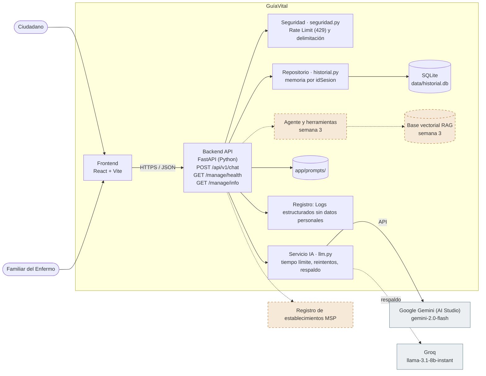
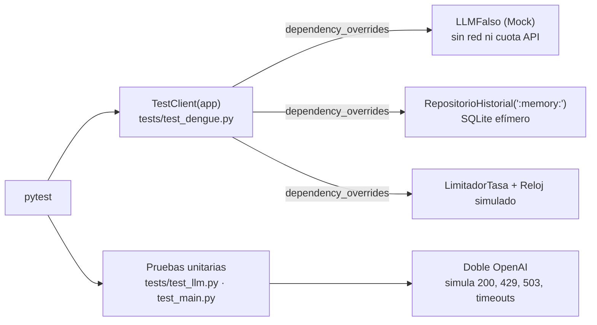

# Arquitectura · GuíaVital

**Caso 05:** Asistente de Orientación en Salud Pública sobre Dengue y Arbovirosis
**Tipo de producto:** Asistente conversacional con RAG y salvaguardas
**Repositorio:** https://github.com/UNIPI6TO/PROY_GRADUACION_ASISTENTE_MEDICO_APP
**Etapa:** Semana 2 · Construcción del MVP e integración con IA generativa

## Problema

La aplicación resuelve el problema de las complicaciones graves por dengue asociadas a la consulta médica tardía y la falta de comprensión ciudadana sobre las guías de salud oficiales. Mediante un asistente de orientación preventivo, busca evitar la saturación del sistema sanitario y promover la búsqueda oportuna de atención cuando aparecen signos de alarma.

## Equipo

| Integrante | Rol |
|---|---|
| Luis Cahuana | Tech Lead |
| Wilson Salinas | Builder |
| Rafael Minaya | QA / Seguridad |

## Diagrama de contexto (C4 nivel 1)

## Diagrama de contenedores (C4 nivel 2)

Los elementos con borde punteado naranja llegan en la semana 3.

## Tecnologías

| Contenedor | Tecnología |
|---|---|
| Frontend | React + Vite |
| Backend | FastAPI (Python) |
| Datos | SQLite |
| Modelo principal | Google Gemini (AI Studio) · gemini-3.5-flash-lite |
| Modelo de respaldo | Groq · openai/gpt-oss-20b |
| Patrón de integración | Enrutamiento por tipo de consulta |
| Registro | Logs estructurados sin datos personales |
| Despliegue previsto | Hugging Face Spaces |

## Endpoints

| Método | Ruta | Propósito |
|---|---|---|
| POST | `/api/v1/chat` | Orientación con salvaguardas, memoria por `idSesion`, límite de tasa y errores RFC 9457 |
| GET | `/manage/health` | Estado del servicio (Liveness y Readiness) |
| GET | `/manage/info` | Información y versión SemVer del servicio |

## Capas del Backend (Principio de Responsabilidad Única)

| Capa / Módulo | Archivo | Responsabilidad |
|---|---|---|
| Controlador HTTP y Contrato | `app/main.py`, `app/schemas.py` | Rutas FastAPI, inyección con `Depends()`, validación Pydantic (`Solicitud`, `RespuestaChat`) y errores `ProblemaRFC9457` (`422`, `429`, `503`, `500`) sin exponer *stack traces* |
| Seguridad OWASP LLM 2025 | `app/services/seguridad.py` | `LimitadorTasa` por `idSesion` (ventana deslizante con respuesta `429` y cabecera `Retry-After`) y `delimitar_consulta` con etiquetas `<consulta_usuario>` contra inyección de prompts |
| Cliente de IA Resiliente | `app/services/llm.py` | Encapsula Gemini y Groq, valida salida JSON contra esquema estricto, aplica reintentos con espera exponencial + *jitter*, soporta historial multi-turno y registra métricas sin PII en `logs/llm.jsonl` |
| Persistencia de Memoria | `app/repositorio/historial.py` | Almacena y consulta los últimos turnos por `idSesion` en SQLite (`data/historial.db`) mediante consultas parametrizadas aisladas por sesión |

## Prompts versionados

Comparativa detallada con 10 entradas de prueba en [`docs/05-prompts.md`](05-prompts.md):

| Archivo | Qué cambia en esta versión |
|---|---|
| `app/prompts/system_v1.md` | Base *zero-shot*: no diagnosticar, no recetar, derivar ante signos de alarma |
| `app/prompts/system_v2.md` | *Few-shot* con 3 ejemplos completos y formato de lectura móvil con viñetas |
| `app/prompts/system_v3.md` | *Guardrails* numerados (1–7), grupos vulnerables, 6 señales de alarma y reglas anti-engaño |
| `app/prompts/system_v4.md` | Criterios explícitos para cada campo JSON (`derivar_a: null` en prevención, `se_abstiene: true` fuera de dominio y lectura de `<consulta_usuario>`) |

## Pruebas Automatizadas con Dobles (Mocks) del Modelo

La arquitectura desacopla las dependencias con `Depends()` en FastAPI y clientes inyectables en `ClienteLLM`, permitiendo que **`pytest -q` valide todo el backend en ~1.5 s sin conexión a internet y sin gastar cuota de API**:

| Suite de Pruebas | Archivo | Doble / Mock Utilizado | Qué Verifica |
|---|---|---|---|
| Endpoint `/api/v1/chat`, Memoria y Seguridad | `tests/test_dengue.py` | `LLMFalso`, `RepositorioHistorial(":memory:")` y `Reloj` inyectados con `app.dependency_overrides` | Contrato `200`, persistencia y memoria multi-turno en SQLite, aislamiento entre sesiones, *rate limit* `429` + `Retry-After`, delimitación anti-inyección `<consulta_usuario>`, validaciones `422` (`texto` e `idSesion`), errores `503`/`500` en formato RFC 9457 sin *stack trace* y abstención ante salida inválida |
| Servicio de IA (`ClienteLLM`) | `tests/test_llm.py` | `Doble` del cliente OpenAI y función `dormir` simulada | Validación de esquema JSON estricto, autocorrección en 1 intento, reintentos ante `429`/`503`/respuesta vacía, respeto de `Retry-After`, espera exponencial y conmutación al proveedor de respaldo |
| Operación y Versionado | `tests/test_main.py`, `tests/test_semver_bumper.py` | Sondas de salud simuladas (*lambdas*) | Diagnóstico `/manage/health` (`200` UP / `503` DOWN), cumplimiento SemVer en `/manage/info` e incremento automático de versión |

## Requisitos no funcionales de IA

| Requisito | Presupuesto |
|---|---|
| Tiempo de respuesta | ≤ 3 s |
| Tokens máximos de salida | 600 |
| Temperatura | 0.2 |
| Caracteres máximos de entrada | 2000 |
| Solicitudes por minuto por usuario | 10 |
| Si el proveedor falla | Reintentar con espera creciente; si sigue fallando, usar el proveedor de respaldo y avisar al usuario |

## Semana 3: herramientas del agente (previstas)

- `evaluar_signos_alarma(respuestas)`
- `ubicar_establecimiento(ciudad)`

## Decisiones de arquitectura

Ver `docs/09-decisiones.md`: ADR-001 Proveedor y modelo generativo (Aceptado); ADR-002 Patrón de integración: workflow o agente (Aceptado); ADR-003 Manejo de claves y datos personales (Aceptado); ADR-004 Signos de alarma por reglas, no por el modelo (Aceptado).

## Uso de la plantilla

Partieron de la propuesta de la plantilla en: Prompts, Requisitos no funcionales. El grupo la revisó y ajustó.
