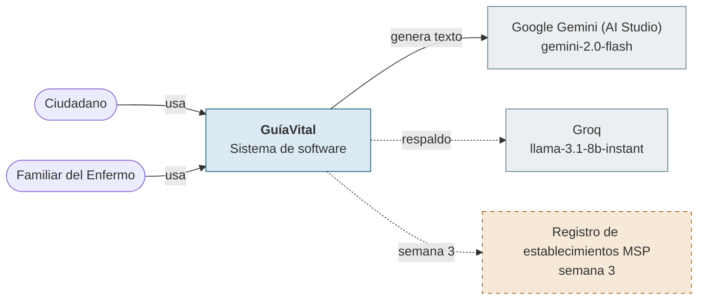
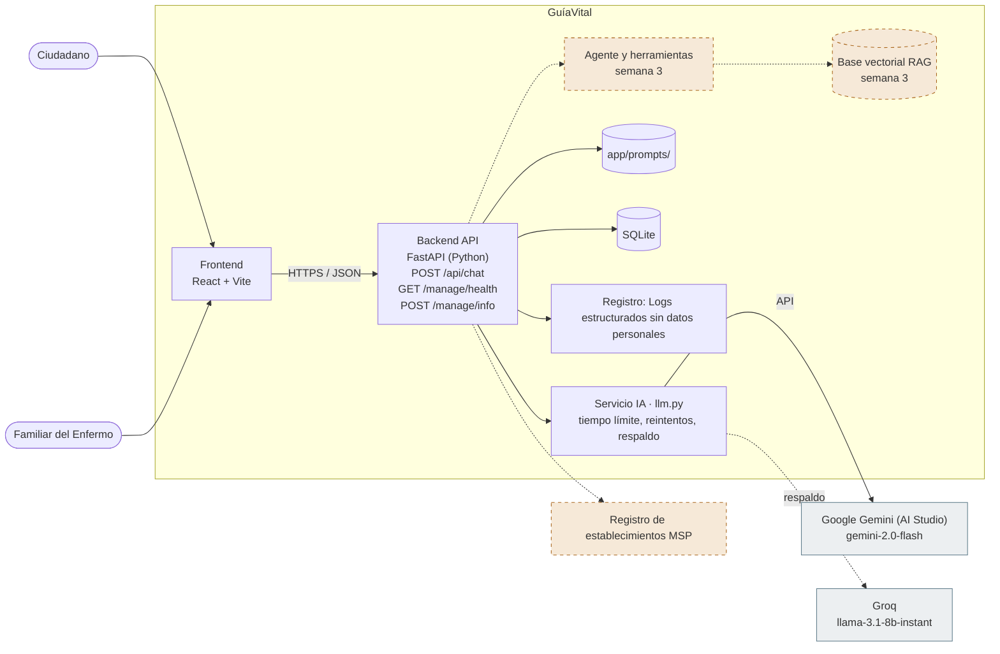

# Arquitectura · GuíaVital

**Caso 05:** Asistente de Orientación en Salud Pública sobre Dengue y Arbovirosis
**Tipo de producto:** Asistente conversacional con RAG y salvaguardas
**Repositorio:** https://github.com/UNIPI6TO/PROY_GRADUACION_ASISTENTE_MEDICO_APP
**Etapa:** Semana 2 · Construcción del MVP e integración con IA generativa

## Problema

La aplicación resuelve el problema de las complicaciones graves por dengue asociadas a la consulta médica tardía y la falta de comprensión ciudadana sobre las guías de salud oficiales. Mediante un asistente de orientación preventivo, busca evitar la saturación del sistema sanitario y promover la búsqueda oportuna de atención cuando aparecen signos de alarma.

## Equipo

| Integrante | Rol |
|---|---|
| Luis Cahuana | Tech Lead |
| Wilson Salinas | Builder |
| Rafael Minaya | QA / Seguridad |

## Diagrama de contexto (C4 nivel 1)

## Diagrama de contenedores (C4 nivel 2)

Los elementos con borde punteado naranja llegan en la semana 3.

## Tecnologías

| Contenedor | Tecnología |
|---|---|
| Frontend | React + Vite |
| Backend | FastAPI (Python) |
| Datos | SQLite |
| Modelo principal | Google Gemini (AI Studio) · gemini-2.0-flash |
| Modelo de respaldo | Groq · llama-3.1-8b-instant |
| Patrón de integración | Enrutamiento por tipo de consulta |
| Registro | Logs estructurados sin datos personales |
| Despliegue previsto | _Por decidir_ |

## Endpoints

| Método | Ruta | Propósito |
|---|---|---|
| POST | `/api/chat` | Orientación con salvaguardas; deriva ante signos de alarma |
| GET | `/manage/health` | Estado del servicio |
| POST | `/manage/info` | Información de la versión del servicio |

## Prompts versionados

| Archivo | Qué cambia en esta versión |
|---|---|
| `app/prompts/system_v1.md` | No diagnosticar, no recetar, derivar ante signos de alarma |

## Requisitos no funcionales de IA

| Requisito | Presupuesto |
|---|---|
| Tiempo de respuesta | ≤ 3 s |
| Tokens máximos de salida | 600 |
| Temperatura | 0.2 |
| Caracteres máximos de entrada | 2000 |
| Solicitudes por minuto por usuario | 10 |
| Si el proveedor falla | Reintentar con espera creciente; si sigue fallando, usar el proveedor de respaldo y avisar al usuario |

## Semana 3: herramientas del agente (previstas)

- `evaluar_signos_alarma(respuestas)`
- `ubicar_establecimiento(ciudad)`

## Decisiones de arquitectura

Ver `docs/09-decisiones.md`: ADR-001 Proveedor y modelo generativo (Propuesto); ADR-002 Patrón de integración: workflow o agente (Propuesto); ADR-003 Manejo de claves y datos personales (Propuesto); ADR-004 Signos de alarma por reglas, no por el modelo (Propuesto).

## Uso de la plantilla

Partieron de la propuesta de la plantilla en: Prompts, Requisitos no funcionales. El grupo la revisó y ajustó.
