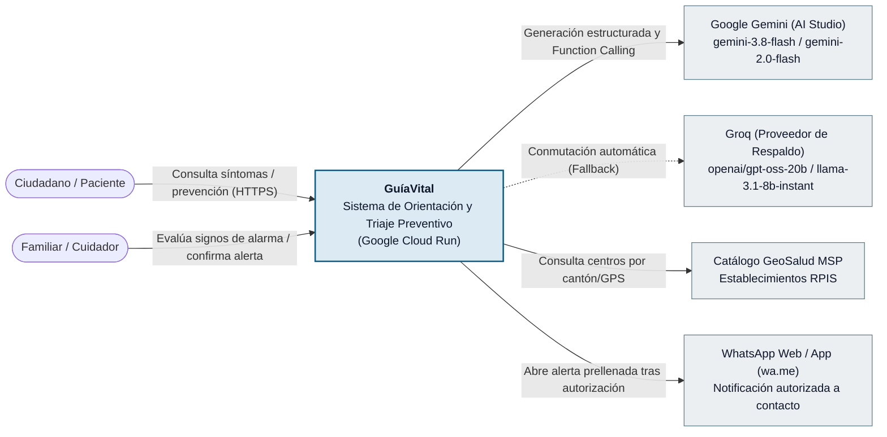
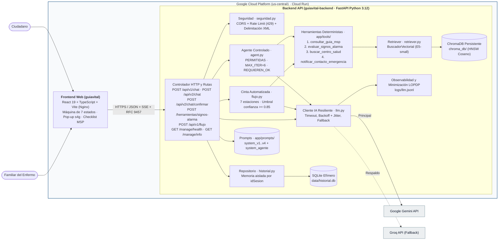
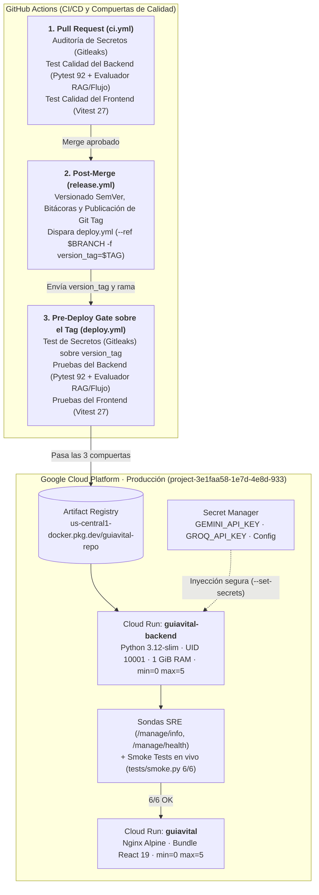
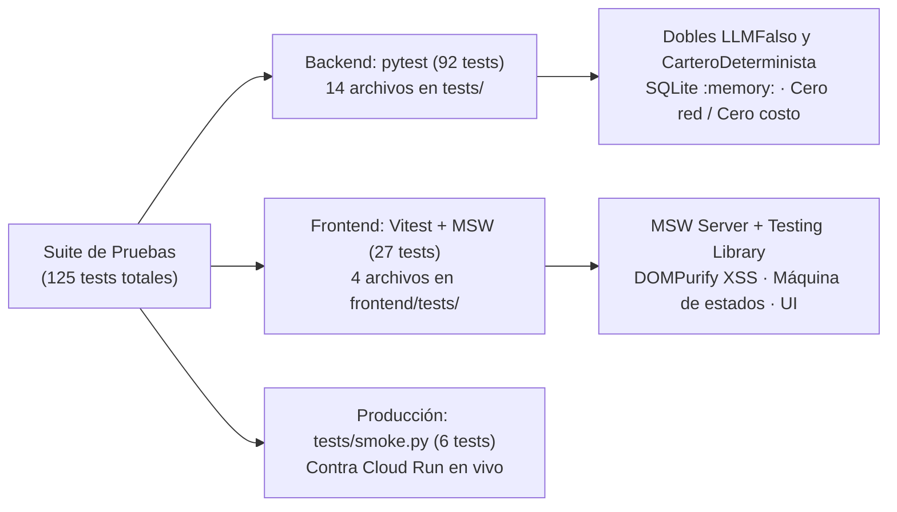

# Arquitectura · GuíaVital (Versión Definitiva · Producción)

**Caso 05:** Asistente de Orientación en Salud Pública sobre Dengue y Arbovirosis  
**Tipo de producto:** Asistente conversacional y Agente de Alcance Controlado con RAG, herramientas deterministas y salvaguardas (*Human-in-the-Loop*)  
**Repositorio:** https://github.com/UNIPI6TO/PROY_GRADUACION_ASISTENTE_MEDICO_APP  
**Frontend Desplegado (Google Cloud Run):** https://guiavital-448060764458.us-central1.run.app  
**Backend API Desplegado (Google Cloud Run):** https://guiavital-backend-448060764458.us-central1.run.app/docs  
**Estado:** Arquitectura Definitiva en Producción (Semana 4 completada)

---

## 1. Problema y Propósito

La aplicación resuelve el problema de las complicaciones graves por dengue asociadas a la consulta médica tardía, la automedicación peligrosa con antiinflamatorios no esteroideos (AINEs como ibuprofeno, aspirina, diclofenaco o naproxeno) y la falta de comprensión ciudadana sobre las guías oficiales de salud. Mediante un asistente y agente preventivo respaldado en lineamientos del Ministerio de Salud Pública (MSP) y la OPS/OMS, evita la saturación hospitalaria, realiza triaje determinista de signos de alarma y promueve la derivación inmediata cuando existe riesgo vital.

## 2. Equipo

| Integrante | Rol | Responsabilidades Principales |
|---|---|---|
| **Luis Cahuana** | Tech Lead | Arquitectura general, pipeline RAG (`intfloat/multilingual-e5-small` + ChromaDB), herramientas deterministas MSP, evolución de prompts y evaluación de calidad (`eval/evaluar.py`). |
| **Wilson Salinas** | Builder | Desarrollo Frontend (`React 19 + TypeScript + Vite`), máquina de 7 estados, integración de endpoints v1/v2 y confirmación *HITL*, contenedorización Docker y CI/CD en Google Cloud Run. |
| **Rafael Minaya** | QA / Seguridad | Estrategia de pruebas automatizadas (`pytest` 92 tests, `Vitest` 27 tests, `smoke.py` 6 casos en vivo), seguridad OWASP LLM, límite de tasa (`LimitadorTasa`) y auditoría de secretos. |

---

## 3. Diagrama de Contexto (C4 · Nivel 1)

Todos los sistemas e integraciones se encuentran **activos en producción** (sin componentes pendientes):

---

## 4. Diagrama de Contenedores (C4 · Nivel 2)

---

## 5. Diagrama de Despliegue y Pipeline CI/CD (Google Cloud Run)

El despliegue se realiza de forma 100% automatizada mediante **GitHub Actions** hacia **Google Cloud Run (`us-central1`)**, protegiendo las credenciales en **Google Secret Manager** y aplicando compuertas de calidad bloqueantes tanto en Pull Request como antes del despliegue:

---

## 6. Matriz Definitiva de Tecnologías

| Contenedor / Componente | Tecnología en Producción |
|---|---|
| **Frontend Web** | React 19 + TypeScript + Vite (servido con Nginx en contenedor Alpine) |
| **Backend API** | FastAPI (Python 3.12-slim, usuario sin privilegios `appuser` UID 10001) + Pydantic v2 |
| **Persistencia de Sesión** | SQLite (`data/historial.db`) aislado por `idSesion` anónimo (política de *Minimización de Datos / LOPDP*) |
| **Base Vectorial (RAG)** | ChromaDB local persistente (`chroma_db/`, índice HNSW con distancia `cosine`) |
| **Modelo de Embeddings** | `intfloat/multilingual-e5-small` (384 dimensiones, asimétrico con `query:` y `passage:`) |
| **Proveedor LLM Principal** | Google Gemini (`gemini-3.8-flash` / `gemini-2.0-flash`) |
| **Proveedor LLM de Respaldo** | Groq (`openai/gpt-oss-20b` / `llama-3.1-8b-instant`) |
| **Patrones de Integración** | 1. Asistente RAG estructurado (`/api/v1/chat`) 2. Agente de Alcance Controlado con *Function Calling* y *HITL* (`/api/v2/chat`) 3. Cinta Automatizada de 7 estaciones con umbral `0.85` (`/api/v1/flujo`) |
| **Observabilidad** | Logs estructurados en JSON Lines (`logs/llm.jsonl`) sin datos personales ni texto del usuario |
| **Infraestructura y Despliegue** | **Google Cloud Run** (`us-central1`) + **Google Artifact Registry** + **Google Secret Manager** + **GitHub Actions** |

---

## 7. Catálogo Completo de Endpoints en Producción

| Método | Ruta | Propósito |
|---|---|---|
| `POST` | `/api/v1/chat` | Asistente conversacional RAG con contrato JSON validado (`RespuestaChat`), memoria por `idSesion`, límite de tasa (`429`) y errores RFC 9457. |
| `POST` | `/api/v2/chat` | Agente de alcance controlado con bucle de razonamiento (`MAX_ITER = 6`), lista cerrada de 4 herramientas, citas validadas y pausa *HITL*. |
| `POST` | `/api/v2/chat/confirmar` | Confirmación o rechazo del usuario (*Human-in-the-Loop*) para ejecutar o cancelar acciones sensibles pausadas (`notificar_contacto_emergencia`). |
| `POST` | `/herramientas/signos-alarma` | Evaluación clínica determinista de signos de alarma de dengue (días de fiebre, edad y signos críticos) bajo protocolo oficial del MSP. |
| `POST` | `/api/v1/flujo` | Cinta de automatización de 7 estaciones con compuerta de confianza (`>= 0.85` automático vs `< 0.85` desvío a revisión). |
| `GET` | `/manage/health` | Diagnóstico operativo *Liveness* y *Readiness* (`200 UP` / `503 DOWN`) sin consumir cuota del modelo generativo. |
| `GET` | `/manage/info` | Metadatos del servicio y versión validada contra expresión regular oficial **SemVer 2.0**. |

---

## 8. Herramientas del Agente Implementadas (`app/tools/`)

Todas las herramientas están implementadas en producción bajo lista cerrada (`PERMITIDAS` en `app/services/agent.py`) y validadas con esquemas Pydantic:

| Herramienta | Archivo | Tipo | Descripción |
|---|---|---|---|
| `consultar_guia_msp` | `app/tools/consultar_guia_msp.py` | Libre (Determinista / RAG) | Consulta fragmentos vigentes en ChromaDB (SIVE-Alerta MSP y Guía OPS 2016) aplicando umbral de distancia máxima (`0.155`) y devolviendo citas verificables. |
| `evaluar_signos_alarma` | `app/tools/evaluar_signos_alarma.py` | Libre (Reglas en código) | Evalúa síntomas y sinónimos coloquiales contra el catálogo clínico oficial de signos de alarma del MSP sin delegar el triaje al LLM. |
| `buscar_centro_salud` | `app/tools/buscar_centro_salud.py` | Libre (Georreferenciada) | Busca establecimientos del MSP por ciudad/cantón o coordenadas GPS ordenando por distancia Haversine y disponibilidad de Emergencia 24h. |
| `notificar_contacto_emergencia` | `app/tools/notificar_contacto_emergencia.py` | **Con Confirmación (`REQUIEREN_OK`)** | Pausa el agente y solicita autorización explícita en la interfaz antes de preparar y abrir el aviso de auxilio hacia el contacto de emergencia (con normalización telefónica E.164 para WhatsApp). |

---

## 9. Capas del Sistema (Principio de Responsabilidad Única · SOLID)

| Capa / Módulo | Archivo | Responsabilidad |
|---|---|---|
| **Controlador HTTP y Contratos** | `app/main.py`, `app/schemas.py` | Rutas FastAPI, CORS, inyección con `Depends()`, validación estricta Pydantic (`extra="forbid"`) y errores estándar `ProblemaRFC9457` (`422`, `429`, `503`, `500`) sin exponer *stack traces*. |
| **Orquestador del Agente** | `app/services/agent.py` | Ejecuta el bucle de razonamiento con lista cerrada (`PERMITIDAS`), tope de iteraciones (`MAX_ITER = 6`), pausa para confirmación (`REQUIEREN_OK`) y reanudación (`reanudar_agente`). |
| **Cinta de Automatización** | `app/flujo.py` | Pipeline determinista de 7 estaciones con cálculo de confianza y desvío seguro a revisión cuando la confianza es `< 0.85` o ante intentos de inyección. |
| **Seguridad OWASP LLM** | `app/services/seguridad.py` | `LimitadorTasa` por `idSesion` (ventana deslizante con `429` y `Retry-After`) y `delimitar_consulta` con etiquetas `<consulta_usuario>` contra *Prompt Injection*. |
| **Recuperación Vectorial (RAG)** | `app/services/retriever.py` | `BuscadorVectorial` con `intfloat/multilingual-e5-small`, prefijos `query: `, filtro de vigencia (`vigente: True`), búsqueda híbrida por código exacto (`CIE-10`) y conversión a `Fuente`. |
| **Cliente de IA Resiliente** | `app/services/llm.py` | Encapsula Gemini y Groq (SDK OpenAI), valida JSON estricto con 1 intento de autocorrección, aplica *backoff* exponencial + *jitter*, soporta *Function Calling* y registra métricas sin PII en `logs/llm.jsonl`. |
| **Persistencia de Memoria** | `app/repositorio/historial.py` | Almacena y consulta los últimos turnos por `idSesion` en SQLite (`data/historial.db`) mediante consultas parametrizadas aisladas por sesión. |
| **Ingesta Reproducible** | `scripts/ingest.py` | Extracción con PyMuPDF, limpieza de marcas de agua y bibliografía, *chunking* jerárquico con encabezado contextual, prefijos `passage: ` e indexación en ChromaDB. |
| **Interfaz Web React** | `frontend/src/` | Máquina de 7 estados (`estados.ts`), mensajes cortos por etapa, tarjeta de autorización *HITL* con integración a WhatsApp (`MensajeChat.tsx`), checklist clínico (`ChecklistSignosAlarma.tsx`) y pop-up de aviso de IA (`Cabecera.tsx`). |

---

## 10. Prompts Versionados (`app/prompts/`)

Comparativa detallada en [`docs/05-prompts.md`](05-prompts.md):

| Archivo | Propósito y Evolución |
|---|---|
| `app/prompts/system_v1.md` | Base *zero-shot*: no diagnosticar, no recetar, derivar ante signos de alarma. |
| `app/prompts/system_v2.md` | *Few-shot* con 3 ejemplos completos y formato estructurado con viñetas. |
| `app/prompts/system_v3.md` | *Guardrails* numerados (1–7), grupos vulnerables, 6 señales de alarma y reglas anti-engaño. |
| `app/prompts/system_v4.md` | Prompt vigente para `/api/v1/chat`: criterios explícitos para cada campo JSON (`derivar_a: null` en prevención, `se_abstiene: true` fuera de dominio y lectura de `<consulta_usuario>`). |
| `app/prompts/system_agente.md` | Prompt vigente para el Agente v2 (`/api/v2/chat`): instrucciones de uso de las 4 herramientas, prohibición de inventar datos fuera del RAG y formato claro para el ciudadano. |

---

## 11. Estrategia de Pruebas Automatizadas (125 Pruebas: 92 Backend + 27 Frontend + 6 Humo)

La arquitectura desacopla las dependencias con `Depends()` en FastAPI y mocks deterministas en Vitest/MSW, permitiendo validar el 100% del sistema en cada Pull Request y antes de cada despliegue:

| Suite de Pruebas | Archivos | Pruebas | Qué Verifica |
|---|---|---:|---|
| **Agente v2, Cinta y Herramientas** | `test_agent.py`, `test_api_v2.py`, `test_flujo.py`, `test_endpoint_signos_alarma.py`, `test_evaluar_signos_alarma.py`, `test_buscar_centro_salud.py`, `test_consultar_guia_msp.py` | 35 | Bucle del agente, lista cerrada, `MAX_ITER = 6`, pausa y confirmación *HITL*, citas validadas, cinta de 7 estaciones con umbral `0.85`, triaje clínico y geolocalización Haversine. |
| **Chat v1, Memoria y Seguridad** | `test_dengue.py` | 20 | Contrato `200`, persistencia multi-turno en SQLite, aislamiento entre sesiones, *rate limit* `429` + `Retry-After`, delimitación anti-inyección `<consulta_usuario>`, validaciones `422` y errores RFC 9457. |
| **RAG, Cliente LLM y Operación** | `test_retriever.py`, `test_llm.py`, `test_main.py`, `test_semver_bumper*.py`, `test_actualizar_changelog.py` | 37 | Extracción de PDFs oficiales, prefijos E5 (`query:` / `passage:`), filtro de vigencia, reintentos con *backoff*, conmutación a respaldo (Groq), `/manage/health`, `/manage/info` y automatización SemVer. |
| **Frontend, Seguridad UI y Contratos** | `cliente.test.ts`, `estados.test.ts`, `manage.test.ts`, `seguridad-y-ui.test.tsx` | 27 | Máquina de 7 estados, parser SSE de trozos partidos, errores RFC 9457, neutralización XSS (`OWASP LLM05`), sesión anónima, pop-up `s4g`, tarjeta de autorización y normalización de WhatsApp. |
| **Pruebas de Humo en Nube** | `tests/smoke.py` | 6 | Salud en vivo (`GET /manage/health`), orientación v1 y v2, rechazo de automedicación, defensa ante *Prompt Injection* y validación `422` en Google Cloud Run. |

---

## 12. Requisitos No Funcionales y Presupuestos Operativos

| Parámetro / Requisito | Valor Configurado en Producción |
|---|---|
| **Tiempo límite del cliente LLM (`LLM_TIMEOUT_SECONDS`)** | `30 s` por intento (con hasta 3 reintentos y *backoff* exponencial + *jitter*) |
| **Tokens máximos de salida (`LLM_MAX_OUTPUT_TOKENS`)** | `2048` tokens |
| **Temperatura (`LLM_TEMPERATURE`)** | `0.2` (determinismo clínico y baja creatividad) |
| **Caracteres permitidos de entrada (`Solicitud.texto`)** | Mínimo `5` y máximo `2000` caracteres |
| **Límite de tasa (`RATE_LIMIT_PER_MINUTE`)** | `10` solicitudes por minuto por `idSesion` (`429 Too Many Requests` + `Retry-After`) |
| **Tope de iteraciones del Agente (`MAX_ITER`)** | `6` vueltas máximas por consulta |
| **Umbral de distancia coseno RAG (`distancia_max`)** | `0.155` (abstención automática si ningún fragmento supera la similitud mínima) |
| **Umbral de confianza en Cinta (`umbral_confianza`)** | `0.85` (desvío automático a revisión humana por debajo del umbral) |
| **Tolerancia a fallos de proveedor** | Reintento automático ante `429`/`503`/timeout y conmutación transparente al proveedor de respaldo (Groq) |

---

## 13. Decisiones de Arquitectura (ADRs)

Documentadas en detalle en [`docs/09-decisiones.md`](09-decisiones.md) y [`docs/10-automatizacion.md`](10-automatizacion.md):
- **ADR-001:** Selección de Google Gemini como proveedor principal y Groq como proveedor de respaldo bajo interfaz unificada compatible con OpenAI.
- **ADR-002:** Evolución de flujo estructurado JSON (`v1`) a Agente de Alcance Controlado con *Function Calling* y confirmación explícita (`v2`).
- **ADR-003:** Arquitectura de *Minimización de Datos (LOPDP)* (identificador de sesión efímero, anonimización irreversible de PII, secretos en Secret Manager y logs sin texto del usuario).
- **ADR-004:** Evaluación de signos de alarma mediante reglas deterministas en código Python (`evaluar_signos_alarma.py`), nunca delegada al criterio libre del LLM.
- **ADR-005:** Cinta de automatización de 7 estaciones con compuerta de confianza `0.85` para garantizar cero errores silenciosos.
