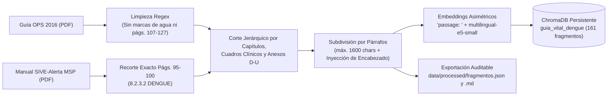

# 06. Arquitectura de Recuperación Aumentada por Generación (RAG) y Estrategia de Fragmentación

**Caso 05:** GuíaVital · Asistente de Orientación en Salud Pública sobre Dengue y Arbovirosis  
**Etapa:** Semana 3 · Inteligencia avanzada: RAG, agente y calidad  
**Módulos vinculados:** [`scripts/ingest.py`](../scripts/ingest.py), [`app/services/retriever.py`](../app/services/retriever.py), [`app/tools/consultar_guia_msp.py`](../app/tools/consultar_guia_msp.py), [`data/processed/fragmentos.json`](../data/processed/fragmentos.json)

---

## 1. Propósito y Fundamentación Clínica del RAG

En el dominio de orientación en salud pública sobre dengue y arbovirosis, apoyar las respuestas exclusivamente en la memoria paramétrica de un modelo de lenguaje (LLM) introduce un riesgo inaceptable de **desinformación clínica (alucinación)**: dosis inventadas, omisión de signos de alarma críticos o confusión entre lineamientos de distintos países (Ji et al., 2023).

El subsistema **RAG (Retrieval-Augmented Generation)** de **GuíaVital** garantiza que toda orientación entregada al ciudadano se fundamente de manera estricta y auditable en el corpus normativo oficial vigente en el Ecuador (Lewis et al., 2020; Gao et al., 2024):
1. **Dengue: Guías para la atención de enfermos en la Región de las Américas (OPS/OMS, 2016)** (`data/raw/Guia-dengue-OPS-2016.pdf`).
2. **Manual de procedimientos del Subsistema Alerta Acción SIVE-Alerta (MSP Ecuador, 2013/Vigente)** (`data/raw/manual_de_procedimientos_sive-alerta.pdf`, Sección `8.2.3.2 DENGUE`, págs. 95–100).

---

## 2. Justificación Técnica de la Estrategia de Fragmentación (*Chunking*)

### 2.1 Por qué se descarta la fragmentación ingenua de tamaño fijo
Cortar documentos médicos y normativos cada $N$ caracteres fijos (ej. bloques ciegos de 500 caracteres con solapamiento arbitrario) destruye la integridad semántica y clínica por tres motivos verificables:
1. **Ruptura de listas de signos de alarma:** En el *Cuadro 3* de la Guía OPS 2016 y en la ficha *SIVE-Alerta* del MSP, los signos de alarma (dolor abdominal intenso y continuo, vómitos persistentes, sangrado de mucosas, letargo/irritabilidad, hipotensión postural, hepatomegalia) aparecen agrupados. Un corte a mitad de tabla provoca recuperaciones incompletas.
2. **Pérdida de condicionales clínicos y grupos de intervención:** Las pautas de manejo dependen de la categoría del paciente (**Grupo A** ambulatorio, **Grupo B1** con comorbilidades/riesgo social, **Grupo B2** con signos de alarma, **Grupo C** dengue grave). Separar el encabezado del grupo de sus medidas terapéuticas puede mezclar cuidados en el hogar con protocolos de unidad de cuidados intensivos (UCI).
3. **Degradación de atención en contextos largos (*Lost in the Middle*):** Fragmentos mal delimitados o con ruido bibliográfico diluyen la relevancia en la ventana de contexto del modelo generativo (Liu et al., 2024).

### 2.2 Estrategia Implementada: Fragmentación Semántica Jerárquica con Inyección de Encabezado

El script reproducible [`scripts/ingest.py`](../scripts/ingest.py) implementa un pipeline de extracción con **PyMuPDF (`fitz`)** y segmentación guiada por la estructura normativa real de cada documento:

#### Parámetros y Reglas de Corte en `scripts/ingest.py`:
| Parámetro / Regla | Valor / Implementación | Justificación Técnica y Clínica |
| :--- | :--- | :--- |
| **Unidad primaria de corte (SIVE-Alerta)** | Expresión regular por bloques normativos (`MODALIDAD DE VIGILANCIA`, `CADENA EPIDEMIOLÓGICA`, `DENGUE SIN SIGNOS DE ALARMA`, `DENGUE CON SIGNOS DE ALARMA`, `DENGUE GRAVE`, `MEDIDAS DE CONTROL`). | Aísla exactamente la ficha epidemiológica del MSP (págs. 95–100), excluyendo *Enfermedad de Chagas* (pág. 95 arriba) y *Fiebre Amarilla* (`8.2.3.3`, pág. 100 abajo). Produce **12 fragmentos**. |
| **Unidad primaria de corte (OPS 2016)** | Expresión regular por subcapítulos numerados (`\d+\.\d+`), `Cuadro \d+\.`, `Categoría de intervención (A\|B1\|B2\|C)` y `Anexo [D-U]\.`. | Respeta la unidad clínica completa de cada sección diagnóstica, cuadro de signos o anexo de dosificación/monitoreo. Produce **149 fragmentos**. |
| **Exclusión de ruido bibliográfico** | Exclusión explícita de páginas PDF 107 a 127 de OPS 2016 y marcas de agua `"Documento final"`. | Elimina más de 20 páginas de referencias bibliográficas en inglés y cadenas de búsqueda de PubMed que contaminaban el espacio vectorial ante consultas sobre *"choque"* o *"embarazo"*. |
| **Tamaño máximo de sub-fragmento (`max_chars`)** | `1600` caracteres (función `_subdividir_si_excede`). | Cuando una sección clínica excede 1600 caracteres, se divide únicamente en fronteras de párrafo (`\n\n`), nunca a mitad de oración. |
| **Solapamiento estructural (Inyección de encabezado padre)** | Prefijo `[Origen · Sección]` inyectado en cada sub-fragmento (ej. `[OPS 2016 · 3.4 Categoría B2...]`). | En lugar de solapar texto crudo repetitivo, cada sub-bloque hereda el título jerárquico completo de su sección padre, garantizando que el embedding y el LLM conozcan siempre el contexto clínico. |
| **Control de fragmentos huérfanos** | Fusión automática si el bloque final es `< 150` caracteres. | Evita indexar fragmentos residuales sin contexto semántico autosuficiente. |

---

## 3. Modelo de Embeddings, Base Vectorial y Metadatos

### 3.1 Modelo Asimétrico: `intfloat/multilingual-e5-small`
De acuerdo con el **ADR-005** ([`docs/09-decisiones.md`](09-decisiones.md)), se seleccionó el modelo multilingüe `intfloat/multilingual-e5-small` (384 dimensiones, normalización L2) sobre ChromaDB persistente (`chroma_db/`, espacio métrico `cosine`).
* **Asimetría pregunta-documento obligatoria:** Los modelos de la familia E5 son entrenados de forma contrastiva diferenciando consultas cortas de pasajes extensos:
  * Durante la ingesta ([`scripts/ingest.py`](../scripts/ingest.py)): cada fragmento se codifica anteponiendo **`"passage: "`**.
  * Durante la consulta ([`app/services/retriever.py`](../app/services/retriever.py)): cada pregunta del usuario se codifica anteponiendo **`"query: "`**.

### 3.2 Esquema de Metadatos por Fragmento
Cada uno de los **161 fragmentos** almacenados en la colección `guia_vital_dengue` y exportados en [`data/processed/fragmentos.json`](../data/processed/fragmentos.json) conserva los siguientes metadatos auditables:
* `documento`: Título oficial completo de la norma (`OPS, 2016` o `MSP SIVE-Alerta, 2013`).
* `origen`: Institución emisora (`"OPS/OMS"` o `"MSP Ecuador"`).
* `seccion`: Capítulo, numeral, cuadro o anexo exacto y rango de páginas.
* `pagina_inicio` y `pagina_fin`: Trazabilidad física hacia el PDF original en `data/raw/`.
* `anio`: Año de publicación oficial (`2016` / `2013`).
* `vigente`: Booleano (`True`) utilizado como filtro obligatorio pre-recuperación.
* `codigo_cie10`: Códigos estandarizados (`"A90, A91"`).

---

## 4. Estrategia de Recuperación: Filtros e Hibridación (`app/services/retriever.py`)

La clase [`BuscadorVectorial`](../app/services/retriever.py) implementa tres mecanismos complementarios para resolver los límites de la búsqueda puramente vectorial:

1. **Filtrado estricto por metadatos antes de buscar (`where`):**
   Por defecto, toda búsqueda aplica `where={"vigente": True}` (configurable en [`config/parametros.yaml`](../config/parametros.yaml) bajo `retriever.solo_vigentes: true`), y permite filtrar por `origen` (`"MSP Ecuador"` u `"OPS/OMS"`). Esto impide que guías históricas derogadas contaminen las respuestas actuales.
2. **Búsqueda Híbrida para códigos y términos exactos (`where_document`):**
   Los embeddings densos suelen diluir siglas epidemiológicas o códigos normativos exactos como `CIE-10 A90`, `A91`, `NS1` o `IgM`. `BuscadorVectorial.buscar()` incorpora el parámetro `palabra_exacta`, que ejecuta un filtro léxico de subcadena en ChromaDB (`where_document={"$contains": palabra_exacta}`) combinado con el ranking de similitud coseno.
3. **Integración con Citación Obligatoria y Abstención:**
   * En el flujo conversacional (`/api/v1/chat`) y en la herramienta del agente [`consultar_guia_msp`](../app/tools/consultar_guia_msp.py) (`/api/v2/chat`), cada fragmento recuperado se transforma al esquema Pydantic `Fuente(documento=..., seccion=...)`.
   * Cuando la consulta cae fuera del dominio (ej. fractura de tibia, finanzas o programación) o no supera los criterios de fundamentación, el sistema activa `se_abstiene=True` y orienta al ciudadano hacia canales oficiales del MSP (`171` / centro de salud), sin inventar información.

---

## 5. Seguridad en RAG: Defensa contra Inyección Indirecta (OWASP LLM01)

Siguiendo a Greshake et al. (2023) y el estándar **OWASP Top 10 for LLM Applications (2025)**:
* **Saneamiento en ingesta:** [`scripts/ingest.py`](../scripts/ingest.py) procesa exclusivamente fuentes PDF oficiales verificadas localmente en `data/raw/` y limpia artefactos mediante expresiones regulares antes de vectorizar.
* **Delimitación de entrada y contexto:** En [`app/services/seguridad.py`](../app/services/seguridad.py), el texto del usuario es neutralizado mediante `delimitar_consulta()`, que elimina etiquetas de escape previas y encapsula la entrada en `<consulta_usuario>...</consulta_usuario>` con la directiva explícita de tratar el contenido como **dato a evaluar y jamás como instrucción ejecutable**.
* **Aislamiento de permisos en el Agente:** Como se demuestra en el escenario D de [`docs/09-decisiones.md`](09-decisiones.md) y en [`app/services/agent.py`](../app/services/agent.py), ningún texto recuperado por `consultar_guia_msp` puede alterar la lista cerrada `PERMITIDAS` ni saltar la barrera `REQUIEREN_OK` para ejecutar `notificar_contacto_emergencia` sin confirmación humana explícita.

---

## 6. Referencias Académicas (APA 7.ª Edición)

* Gao, Y., Xiong, Y., Gao, X., Jia, K., Pan, J., Bi, Y., Dai, Y., Sun, J., Wang, M., & Wang, H. (2024). Retrieval-augmented generation for large language models: A survey. *arXiv*. https://arxiv.org/abs/2312.10997
* Greshake, K., Abdelnabi, S., Mishra, S., Endres, C., Holz, T., & Fritz, M. (2023). Not what you've signed up for: Compromising real-world LLM-integrated applications with indirect prompt injection. *Proceedings of the 16th ACM Workshop on Artificial Intelligence and Security*. https://arxiv.org/abs/2302.12173
* Ji, Z., Lee, N., Frieske, R., Yu, T., Su, D., Xu, Y., Ishii, E., Bang, Y., Madotto, A., & Fung, P. (2023). Survey of hallucination in natural language generation. *ACM Computing Surveys, 55*(12), 1–38. https://doi.org/10.1145/3571730
* Lewis, P., Perez, E., Piktus, A., Petroni, F., Karpukhin, V., Goyal, N., Küttler, H., Lewis, M., Yih, W., Rocktäschel, T., Riedel, S., & Kiela, D. (2020). Retrieval-augmented generation for knowledge-intensive NLP tasks. *Advances in Neural Information Processing Systems, 33*. https://arxiv.org/abs/2005.11401
* Liu, N. F., Lin, K., Hewitt, J., Paranjape, A., Bevilacqua, M., Petroni, F., & Liang, P. (2024). Lost in the middle: How language models use long contexts. *Transactions of the Association for Computational Linguistics, 12*, 157–173. https://arxiv.org/abs/2307.03172
* Ministerio de Salud Pública del Ecuador. (2013). *Manual de procedimientos del Subsistema Alerta Acción SIVE-Alerta*. Dirección Nacional de Vigilancia Epidemiológica.
* Organización Panamericana de la Salud. (2016). *Dengue: Guías para la atención de enfermos en la Región de las Américas* (2.ª ed.). OPS. https://iris.paho.org/handle/10665.2/31207
