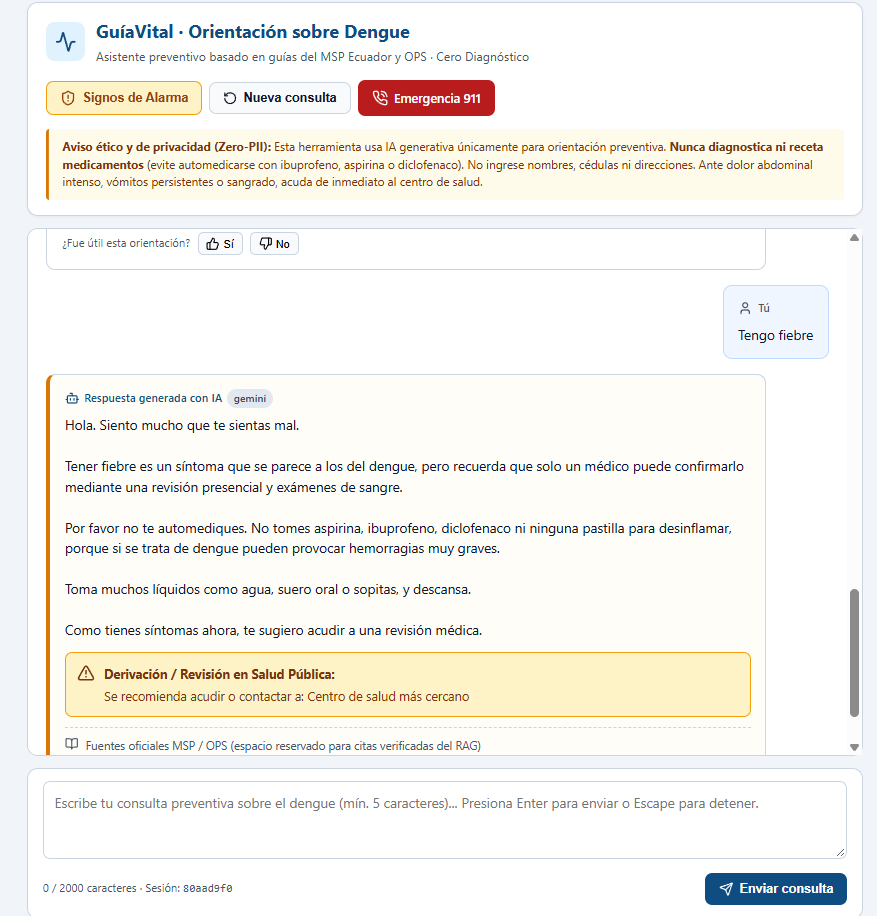

# Evidencia técnica · Semana 2

Caso 05 · GuíaVital · Revisión 2: viernes 23 de octubre de 2026

## Lista de verificación

- [x] Arquitectura y decisiones documentadas (docs/03-arquitectura.md y docs/09-decisiones.md (ADR-001 a 003))
- [x] La clave fuera del código desde el primer commit (.env en .gitignore, .env.example sin valores, historial limpio)
- [x] Un servicio que encapsula al modelo (app/services/llm.py: cambiar de proveedor no toca los endpoints)
- [x] Endpoint principal con entrada validada (POST /chat, /analizar, /clasificar o /planificar con Pydantic)
- [x] System prompt en archivo y tres versiones comparadas (app/prompts/system_v1.md … v3 y docs/05-prompts.md)
- [x] Errores del proveedor bajo control (429 con reintentos y espera creciente, tiempo agotado, respuesta vacía)
- [x] Registro por solicitud (tokens consumidos y tiempo de respuesta en cada llamada)
- [x] Pruebas automatizadas con un doble del modelo (tests/ con pytest; corren sin internet y sin gastar API)
- [x] Frontend propio del producto (chat, formulario con informe, tablero, calendario o mapa)
- [x] README que permite ejecutar el proyecto (instalación, variables de entorno y cómo correr backend y frontend)
- [x] Evidencia técnica de la semana (docs/evidencias/semana-2/: capturas, prompts, decisiones y problemas)

## Bitácora diaria

| Día | Qué funciona (captura) | Problema encontrado | Cómo lo resolvimos | Quién |
|---|---|---|---|---|
| Lun 19 | | | | |
| Mar 20 | | | | |
| Mié 21 | |El bot devolvia frases muy tecnicas y a los usuarios se les dificultaba interpretar |Agregando el prompt-3 una condicion para que la respuesta sea mas amigable | |
| Jue 22 | | | | |
| Vie 23 |  |El chat simepre daba informacón de derivar a Emergencias o llamar al 911 |Se creo una nieva version del prompt agregando esta regla|Wilson Salinas |

## Capturas

Guarden las imágenes en esta misma carpeta y enlácenlas aquí.

## Respuestas preparadas para la revisión

1. ¿Dónde está la clave del modelo? En el archivo env
2. ¿Qué pasa si el proveedor devuelve 429? El services llm.py orquesta la petición y la deriva al modelo de backup
3. ¿Por qué esa temperatura y ese límite de tokens? 
- Controla el nivel de creatividad. Valores bajos (cerca de 0) hacen que el modelo sea más preciso, analítico y predecible (ideal para programación o datos objetivos). Valores altos (cerca de 1) generan respuestas más creativas, diversas y menos rígidas. En nuestro caso usamos low para el caso del grupo 5. 
- Controla la longitud máxima de la respuesta. Se ajusta para evitar que el modelo genere textos interminables o se desvíe del tema.
4. ¿Qué aprendimos al comparar los tres prompts? 
Aprendimos que las instrucciones generales (v1, 50% de acierto) no bastan en salud: añadir ejemplos concretos few-shot (v2, 70%) aseguró el formato móvil al 100% y eliminó invenciones, pero recién al definir reglas explícitas para grupos vulnerables, las 6 señales de alarma y guardrails anti-inyección (v3/v4, 100%) logramos triaje seguro, bloqueo fuera de dominio y derivación precisa (derivar_a: null en prevención).
